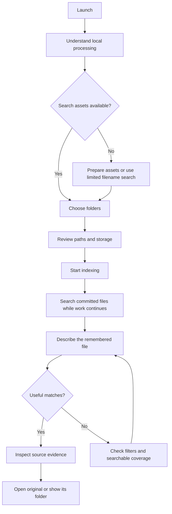
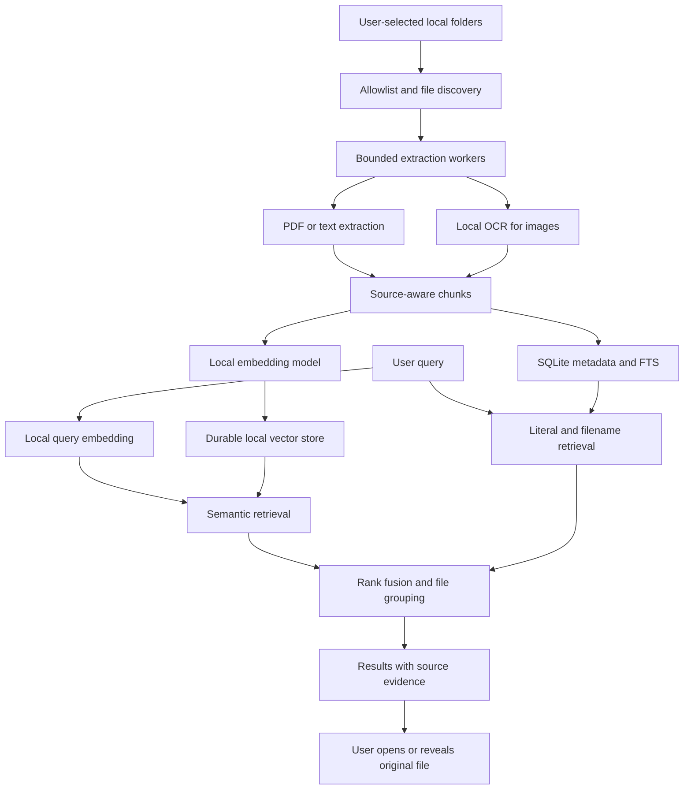

# OmniFind Local — Consolidated Product, Engineering, and UI/UX Master Plan

Updated October 10, 2026, Asia/Manila. Revision 3: implementation and evidence audit against repository commit `7a00418`.

**Revision focus:** reconcile the specification with the working desktop and authorized phone-local Android pilots, record reproducible checks, update delivery gates, and separate historical measurements from release claims.

This master plan integrates the complete application plan and detailed UI/UX plan into one implementation and design reference. It retains the technical architecture, indexing/retrieval details, privacy controls, hardware assumptions, roadmap, judging/demo guidance, five main journeys, twelve screens/panels, three consequential overlays, wireframes, visual system, copy, accessibility guidance, handoff contracts, and engineering/UX acceptance criteria.

**Status:** working desktop and Android pilots; public-release and independent-user acceptance gates remain incomplete. This document preserves the proposed design requirements below while identifying delivered behavior and gaps in the current audit. Planned screens, timings and capacity targets are not automatically implemented facts.

**Build target:** Windows desktop plus the user-authorized Android phone-local app. Both are CPU-first, English-first, explicitly scoped and locally indexed. No cloud inference, sync, LAN companion, iOS build or autonomous file mutation is included. Platform capabilities and evidence are separate.

Original sources, preserved unchanged:

- [Application plan](C:/Users/vince/.codex/.chatgpt-projects/g-p-6ac87a67ba5c8191ac48bf44f8119ac5/OMNIFIND_LOCAL_COMPREHENSIVE_PLAN.md)
- [UI/UX plan](C:/Users/vince/.codex/.chatgpt-projects/g-p-6ac87a67ba5c8191ac48bf44f8119ac5/OMNIFIND_LOCAL_UI_UX_PLAN.md)

### Decisions reconciled across the source plans

| Topic | Consolidated decision |
|---|---|
| Desktop versus mobile skill | Windows desktop and authorized Android phone-local indexing are implemented pilots; section 33 defines current Android scope |
| Setup versus first-run overview | Prepare/validate search assets, then confirm roots and index; limited filename mode may enter before assets are ready |
| Screenshot scope versus UI priority | Tier B is the intended screenshot journey; if time is insufficient, disclose it as deferred. A P1 design priority does not override the chosen release tier |
| Clearing index versus preserving roots | Current desktop Clear index forgets all selected roots; original files and public models remain. Android removes individual selected roots and grants. Retaining cleared root configuration is superseded |
| Search filters | UI filters restrict the eligible corpus before candidate truncation; do not globally retrieve then discard all filtered matches |
| Preview and opening | Selecting previews without opening; Enter opens only when a result/control, rather than query input, has the appropriate focus |
| Locality and RAM | Same-machine processing with durable local-disk index; no claim that the entire corpus stays in RAM |
| Evidence and measurements | Preserve historical contrast/retrieval records; current audit distinguishes fresh checks, earlier builder observations and unverified release targets |
| Unsupported/unknown details | Retain explicit limitations and unresolved decisions; never fill them with invented facts |

### Current implementation audit — October 10, 2026

Main repository: [zekurou1/appbuildersph-hackathon-2026](https://github.com/zekurou1/appbuildersph-hackathon-2026). Local checkout and recorded `origin/main` were at `7a00418` when this review began. Repository visibility and current organizer announcements could not be independently fetched by the web tool; successful authenticated pushes are not proof of public visibility.

The audit inspected current source, manifests, model provenance, packaging workflow, evidence reports and Git history. Fresh checks ran on the builder's Windows host: the desktop suite ran 41 tests, with **40 passed and one symlink test skipped**; actual directory-junction coverage passed. `scripts/verify_gui.py` passed the real-MiniLM offscreen desktop journey including screenshot OCR, keyboard/large-text states, freshness, clear/rebuild and cross-window revocation. Mobile `flutter analyze` found no issues and **all five widget tests passed**. `scripts/verify_mobile_artifact.py` reverified the actual APK, model hashes, native OCR libraries/notices, backup setting and absent Internet/network-state permissions; it checked the existing **14 passing native test results**, rather than rerunning instrumentation in this audit.

Earlier Android release observations are recorded in `docs/mobile-flow-verification.json`, `docs/mobile-pdf-verification.json` and `docs/mobile-ocr-verification.json`: actual system subfolder selection, indexing/search/evidence/open, process restart, removal and unchanged synthetic originals. First-use image OCR/search/original viewing ran in airplane mode with Wi-Fi disabled; settings were restored. These observations were inspected, not repeated during this revision. The APK is **254,681,402 bytes (about 243 MiB)**, SHA-256 `59a387c24059f6ec2b6c473d232b073edcf37a5644bb2726245b6711325c9871`, debug-signed for pilot use.

| Capability | Windows desktop pilot | Android phone-local pilot |
|---|---|---|
| Shell and inference | Python/PySide6, CPU PyTorch/Transformers MiniLM | Flutter UI, Kotlin worker, CPU ONNX Runtime MiniLM |
| Text formats | Digital PDF, UTF-8 TXT/Markdown | TXT/Markdown; digital PDF requires Android 15/API 35+ |
| Readable-image OCR | English PNG/JPEG through Windows.Media.Ocr; source and frozen runner evidence | English upright PNG/JPEG through bundled Tesseract4Android 4.9.0 / Tesseract 5.5.1 |
| Retrieval/evidence | Filename/lexical/semantic/hybrid, folder/type filters, page/line/OCR evidence, bounded thumbnail, Open/Reveal | Words only / Meaning + words, source line/page/OCR evidence, native Open; no type/folder search filters or image highlighting |
| Durable scope | SQLite/FTS/vectors, manual reconciliation, transactional clear/removal, root boundary checks | App-private SQLite/vectors, selected local-provider tree grants, manual refresh, freshness/open checks, per-root removal; schema v3 preserves text/PDF passages |
| Parser containment | Windows Job Object: memory/process/time/output limits and parser termination | In-process PDF/OCR with byte/pixel/page/text limits; hard timeout and killable parser isolation are missing |
| Distribution | Unsigned pilot package; separate Server 2025 install/uninstall checks; builder executable blocked by Application Control | Built universal release APK, debug signing; emulator installed; physical phone/store release not validated |

Desktop MiniLM revision is `1110a243fdf4706b3f48f1d95db1a4f5529b4d41` (asset manifest `docs/model-assets.json`); a BGE development comparison exists, but MiniLM remains the default. Android uses MiniLM ONNX revision `10dbd2f06a8baf40ad285b037edda610c1b9a57c` with four tested tokenizer/vector fixtures; this is not a general tokenizer-quality guarantee. OCR English data is pinned at `87416418657359cb625c412a48b6e1d6d41c29bd`, 4,113,088 bytes, with SHA verification and bundled notices. Public dependencies/models are downloaded on the build machine; runtime has no cloud inference fallback. Plaintext local derivatives are not encryption. External viewers and OS services remain outside the verified egress boundary.

**Retrieval evidence:** the original frozen synthetic holdout reported gated Recall@5 **84%**, below the proposed 85% target, with 18/20 absent targets rejected. The exact-code fix recovered all 50 relevant queries on the reused regression set; **100% regression reuse is not new holdout validation**. Two semantic absent-query false accepts remain. Historical gated warm p95 was 174 ms on only 20 short documents/20 chunks; this is not an Android measurement, current-policy latency claim, 50 GB capacity proof or user-task benchmark. See `docs/HOLDOUT_EVALUATION.md` and `docs/IDENTIFIER_RECOVERY.md`.

**Readiness:** the core build exists; the entire master specification and public release are unfinished. An overall completion percentage is omitted because the work packages have different effort and include gates not satisfied by source/tests alone.

Priority work, with acceptance gates:

1. **Android safety and hardware:** add interruptible/isolated native extraction and a hard timeout, then run first-use offline, cancellation, background/resume, revoked grants and memory/thermal/latency tests on a physical phone. Cancellation currently waits for the native recognition call to return.
2. **Fresh retrieval validation:** freeze a new corpus/query set before testing the changed policy; include PNG/JPEG OCR, near-codes, long passages, absent targets and mobile cases. Report both relevant-file recall and false accepts; keep development/regression/holdout separate.
3. **Usability/accessibility:** conduct independent correct-original tasks and keyboard/Narrator/TalkBack checks with consent. Doubled-text widget/offscreen checks and accessibility-tree inspection do not establish screen-reader usability.
4. **Distribution/privacy:** test an approved Windows 11 signing/execution route without weakening Application Control; profile Android ABI-specific packaging; measure OS/process/service egress with scoped synthetic traces and audit notices/disclosures.
5. **Product expansion after reliability:** consider mobile filters and image highlighting; defer DOCX, scanned-PDF OCR, automatic watchers, broader languages and visual scene understanding until separately built/tested.

Audit findings to keep visible: current mobile code tokenizes periods separately, unlike the desktop exact-code route; punctuation-rich identifiers such as `QXZ.471` need dedicated parity/recovery tests before promising the desktop contract on Android. Android also re-reads source bytes for freshness during search; larger-corpus query latency must be measured. Neither finding was demonstrated as a runtime failure during this audit.

The detailed sections below are the design and engineering contract. Where they differ from delivered behavior, this audit and the dated platform evidence take precedence for **current status**, while unfinished requirements remain acceptance work.

### Reading paths

- Product and scope: sections 1-3.
- Complete UI/UX specification: sections 4-18.
- Architecture and engineering: sections 19-26.
- Delivery, verification, demo, and release: sections 27-32.
- Current Android scope, unresolved decisions, and provenance: sections 33-35.

### Contents

1. Product vision, assumptions, and success
2. Users, tasks, and research questions
3. Scope, tiers, and priorities
4. Design principles
5. Information architecture and session state
6. User journeys
7. Screen and overlay inventory
8. First-run setup specifications
9. Search workspace and filtering
10. File results, evidence, and freshness
11. Folder management, progress, and issues
12. Settings, data removal, and trust
13. Wireframes
14. Visual identity and design tokens
15. Responsive layout and Windows behavior
16. Components, motion, and keyboard interaction
17. UX copy library
18. Accessibility and recorded contrast checks
19. Technical architecture and local data flow
20. Indexing, extraction, and revision lifecycle
21. Retrieval and ranking
22. Data model and application modules
23. UI-to-backend contracts
24. Hardware, capacity, and resource management
25. Privacy, storage, and security
26. Failure recovery and model lifecycle
27. Implementation and design delivery roadmap
28. Engineering, usability, and acceptance verification
29. Hackathon evidence, judging, and rule review
30. Demo corpus, video, and live presentation
31. Release, costs, distribution, and maintenance
32. Risks and readiness gates
33. Authorized phone-local Android implementation
34. Requirement traceability and unresolved decisions
35. Sources, provenance, and consolidation coverage

## 1. Product vision, assumptions, and success

Build a Windows desktop application that finds files from what the user remembers about their contents. The user selects folders, the app indexes supported files locally, and natural-language queries return real files with evidence explaining the match.

**Product promise:** “Describe the file you remember. Find it on your computer.”

**Primary outcome:** the user locates, verifies, and opens the correct existing file without remembering its filename or uploading its contents to an AI service.

The defining workflow is search → evidence → open or reveal in File Explorer. A chat interface and generated answers are optional future features. Local embeddings and OCR already provide meaningful AI functionality for the main workflow.

### Interpretation of the supplied image

| Concept element | Product interpretation | Necessary qualification |
|---|---|---|
| Digging through Downloads, Desktop, Documents | Search user-selected folders across a personal file collection | Never scan these folders automatically without selection |
| “That PDF with my landlord’s deposit rules” | Retrieve based on document contents despite an unrelated filename | Match evidence must come from the actual file |
| “Screenshot of my class schedule” | Recognize screenshot text locally and search its meaning | OCR supports text-bearing screenshots; it does not understand every visual scene |
| A 50 GB private desktop collection | Long-term corpus-size scenario | Bytes alone do not predict indexing time or memory use |
| Instant file location | Fast search after indexing | First-run indexing and OCR take time; latency must be measured |
| “100% in local RAM” | All inference and index processing occurs on the same machine | Persist the index on local disk; load models and active search data into RAM |
| Cloud uploads leak personal files | Avoid sending indexed content to remote inference | Uploading creates a remote data path; do not claim every cloud service leaks data |

### Working assumptions

- Windows 11 x64 is the initial development target; actual supported builds must be tested before release.
- A CPU-only laptop is the baseline. GPU acceleration is optional.
- The first build supports English queries and documents. Filipino and Taglish are evaluation tracks, not promised capabilities.
- Internet may be used for explicit installation and model downloads. Once assets are installed, indexing and search should work offline.
- Only explicitly selected local folders are indexed. Network shares and cloud-only placeholders are excluded initially.
- There is no account, cloud inference, remote synchronization, or content telemetry in the MVP.
- Team size, remaining hackathon time, available hardware, and existing code are unknown. The plan includes reduced-scope paths.

### Design objectives

1. Let a first-time user understand what the app reads and stores before selecting personal folders.
2. Make natural-language search obvious without presenting an unnecessary chat conversation.
3. Help the user verify the correct file through real excerpts, locations, dates, and previews.
4. Explain incomplete coverage, setup, and stale content without requiring knowledge of embeddings or databases.
5. Keep search useful while background work proceeds and make pause/recovery understandable.
6. Give users direct control over selected folders and derived index data.
7. Support keyboard, screen-reader, larger-text, and narrow-window use from the first design pass.

### What counts as success

The user completes a task when the intended file opens or its location is revealed and the user recognizes it as correct. A displayed result, attractive mockup, or model response alone is insufficient.

Measure correct-file completion, time to correct open, incorrect opens, evidence use, comprehension of indexing/privacy, and successful recovery. The source plan's Recall@5 and warm latency targets are engineering goals, not observed UX outcomes.

## 2. Users, tasks, and research questions

### Initial user

A college student or early-career professional who saves PDFs, receipts, assignments, agreements, and screenshots with inconsistent filenames. They remember the subject or situation but cannot remember where the file went.

Useful secondary users include freelancers finding client instructions, tenants finding agreements, and individuals retrieving purchase documents. Enterprise search and regulated organizational deployments require separate validation and security work.

### Jobs the product should complete

| Situation | Example query | Useful result |
|---|---|---|
| Filename is meaningless | “PDF explaining when my rental deposit is refundable” | Agreement PDF, relevant page and passage |
| Information is inside an image | “Screenshot with my Tuesday class schedule” | Screenshot thumbnail and recognized schedule text |
| User remembers a business detail | “Receipt for the monitor I bought” | Receipt image/PDF with matching item text |
| Several versions exist | “Project instructions mentioning the final presentation” | Ranked documents with dates and distinguishing excerpts |
| User remembers an exact fragment | “AB-48172” | Literal match rather than a merely similar document |

### Provisional user archetypes

These are provisional task-based archetypes, not validated personas.

| Archetype | Situation | Remembered clue | Design implication |
|---|---|---|---|
| Student | Timetables and assignments saved inconsistently | Subject, weekday, class requirement | Screenshot evidence and simple type filters |
| Early-career professional | Receipts and agreements mixed with downloads | Purchase item or contractual condition | Content passages, date, and visible source path |
| Freelancer | Several client-instruction versions | Deliverable or distinctive instruction | Version distinction, multiple candidates, freshness |
| Keyboard or assistive-technology user | Needs reliable navigation without precise pointing | Same task clues as others | Semantic controls, focus order, shortcuts, readable evidence |

Research unknowns include how people phrase remembered clues, whether they trust OCR, which formats dominate, how much setup they tolerate, and what they believe “remove folder” does. No demographics or fictional quotes are needed to resolve these questions.

## 3. Scope, tiers, and priorities

### Hackathon MVP: one complete journey

1. Select one or more folders with clear indexing consent.
2. Discover PDF, TXT, Markdown, PNG, and JPEG files.
3. Extract text from digital PDFs and text files; apply local OCR to screenshots/images.
4. Create local text embeddings and a lexical index.
5. Search with ordinary language and optional explicit file-type/folder filters.
6. Return ranked file cards with an evidence snippet, path, date, and index status.
7. Show a text or image preview; open the original or reveal its location.
8. Refresh the index, survive restart, report failures, and forget an indexed folder.
9. Demonstrate fresh queries and new-file indexing without internet after setup.

A manual refresh is acceptable in the hackathon build if disclosed. Reliable persistence and folder removal are more valuable than a fragile always-on watcher.

### Scope tiers

| Tier | Included | Exit condition |
|---|---|---|
| A: core local retrieval | Text PDFs/TXT/MD, semantic plus literal search, evidence, open/reveal, persistence | Entire workflow works offline on the demo laptop |
| B: intended screenshot experience | PNG/JPEG OCR, thumbnail/text preview, visible extraction failures | Class-schedule screenshot is found from its contents |
| C: post-hackathon MVP | DOCX, scanned-PDF OCR, background watching, installer, broader test corpus | Repeatable installation and incremental indexing work |
| D: later product | Visual image embeddings, multilingual validation, optional summaries, macOS | Each addition demonstrates user value and fits hardware/privacy budgets |

If Tier B cannot be finished, retain the PDF retrieval demo and explicitly describe screenshot support as unfinished. Do not present a keyword-only fallback as the full Local AI build.

### Deliberately deferred

File deletion, automatic cleanup, autonomous renaming, cloud drives, LAN serving, email ingestion, browser-history access, full desktop monitoring, face recognition, audio/video indexing, password recovery, arbitrary archives, and a general-purpose AI agent.

### Interface scope

Do not add authentication or a dashboard before it serves the file-finding task. Query history is off by default. Unimplemented formats and future features must not appear as working controls.

### Release contract and differentiating hypothesis

Release A proves English digital-PDF/text finding on the actual Windows laptop; A+B additionally proves readable screenshot OCR. Freeze the declared tier before final evaluation, and publish supported formats/exclusions. Optional scope cannot displace privacy, recovery, or reproduction.

The differentiating hypothesis is **remembered meaning plus source evidence reduces wrong-file browsing in private, messy folders**. Validate paired user tasks, lexical/semantic ablation, and a screenshot with an unrelated filename. Do not claim invention of semantic search or superiority over all desktop/cloud tools. If the benefit is absent, improve retrieval or narrow the task before adding an LLM.

## 4. Design principles

**Search stays central.** A persistent search field and results workspace replace a conversation feed. There is no Send button shaped like a message composer and no assistant avatar.

**Evidence precedes confidence.** Show extracted source passages and recognized screenshot text. Avoid invented explanations, certainty percentages, or badges implying that ranking is proof.

**Progress represents actual work.** Separate finding files, reading contents, and preparing semantic search. Show searchable coverage rather than one misleading total.

**Locality is explained at the relevant moment.** Setup explains downloads; folder selection explains reading/storage; settings explain retention/removal. Avoid oversized security badges that promise more than the implementation proves.

**Recovery preserves effort.** Keep entered queries and filters when a request fails, preserve committed index data, and offer a next action that corresponds to the failed stage.

**Optional complexity stays secondary.** Technical diagnostics, raw timing, and model identity live in details/settings or a demo view, not the ordinary search flow.

## 5. Information architecture and session state

Use three stable destinations: **Search**, **Folders**, and **Settings**. Indexing details are a task-related panel reachable from Search and Folders, not a separate analytics destination.

```text
OmniFind Local
├── First-run setup
│   ├── Introduction and local processing explanation
│   ├── Search asset preparation
│   ├── Folder selection and review
│   └── First indexing / enter Search
├── Search
│   ├── Query + type/folder filters
│   ├── File results
│   ├── Evidence preview
│   └── Index progress / issue details
├── Folders
│   ├── Selected roots and coverage
│   ├── Add / refresh / pause
│   ├── Exclusions and issues
│   └── Remove from index
└── Settings
    ├── Appearance and accessibility
    ├── Privacy and local data
    ├── Search assets and recovery
    └── About / content-free diagnostics
```

Use a modest navigation rail on wide windows and a labeled compact navigation control on smaller windows. Do not invent extra destinations for “AI,” “History,” or “Dashboard.” Query history is disabled by default and does not require a standalone screen.

Switching destinations preserves the current query, filters, selected file, and list position in memory. Closing the application discards query/session state when history is off. Durable indexing configuration is preserved independently.

## 6. User journeys

### A. First successful search



### B. Returning search

Launch → restore folders/index configuration → prepare the local model asynchronously → show Search immediately → run a new query → inspect evidence → open original. If model loading fails, expose limited lexical search and recovery. Do not replay completed onboarding or silently send the query remotely.

### C. Add and refresh a folder

Folders → Add folder → native chooser → review canonical path and overlapping roots → confirm indexing → background progress → search newly committed files. Refresh existing folders uses the same progress/issue patterns. Manual refresh is disclosed; do not imply changes are already watched automatically.

### D. Remove a folder

Folders → Remove from index → scoped confirmation → immediately exclude the root from search/new jobs → clean derivatives → report completion or partial cleanup → remain in Folders. Existing query results/preview from that root disappear immediately; focus moves to an appropriate surviving item.

### E. Recover a stale result

Result selected → source differs from indexed revision → stale notice → refresh that file/root if supported → replace evidence only after successful indexing → preserve query and selection identity when possible. Opening the existing original remains available with explicit notice that the displayed passage may differ; it is never opened as an automatic recovery action.

## 7. Screen and overlay inventory

Screen identifiers are handoff references, not requirements for separate windows.

| ID | Screen/panel | Purpose and entry | Main action | Main states |
|---|---|---|---|---|
| S01 | Welcome | First launch | Set up search | New, setup resumed |
| S02 | Search preparation | Missing/loading assets | Download/prepare or retry | Ready, downloading, loading, canceled, offline, failed, low disk |
| S03 | Folder selection/review | Setup or Add folder | Start indexing | None selected, valid, duplicate, unavailable, excluded |
| S04 | Index progress | Setup/status indicator | Continue to Search | Discovering, processing, paused, finishing, issues, ready |
| S05 | Search workspace | Main destination | Search | Empty query, running, matches, no strong match, limited mode |
| S06 | Evidence preview | Select result | Open file | Text/PDF excerpt/image, stale, missing, unsupported preview |
| S07 | Filter control | Search | Apply selection | All, scoped, invalidated root |
| S08 | Folder manager | Folders destination | Add/refresh | Empty, enabled, unavailable, indexing, paused, removed |
| S09 | Index issue details | Progress/folder issue count | Retry eligible failures | Failed, skipped, unsupported, pending |
| S10 | Privacy/local data | Settings | Manage retained data | No data, populated, clearing, partial failure |
| S11 | Appearance/accessibility | Settings | Apply preference | System/light/dark, text scale, reduced motion |
| S12 | Assets/diagnostics | Settings/recovery link | Retry preparation | Available, absent, failed, migration pending |
| O01 | Remove-root confirmation | S08 | Remove from index | Ready, cleanup pending, failed |
| O02 | Clear-index confirmation | S10 | Clear index | Ready, clearing, partial cleanup |
| O03 | Model-removal confirmation | S12 | Remove search assets | Ready, removing, affected capability explained |

## 8. First-run setup specifications

### S01 — Welcome

Hierarchy: app name → product promise → one brief example → local processing explanation → primary setup action → optional synthetic sample path.

Suggested copy: “Find files by what you remember about them.” Supporting copy: “Choose folders on this computer. OmniFind reads supported files and saves a searchable index here.”

Primary: **Set up search**. Secondary: **Try sample files**, only when a bundled synthetic corpus exists. No login, upsell, carousel, or request for entire-drive access.

State preservation: when setup was interrupted, **Continue setup** resumes the last confirmed step. Returning users bypass this screen.

### S02 — Search preparation

Show asset purpose, exact verified download size, required free space, destination, and whether internet is currently needed. Plain language: “Prepare meaning-based search”; technical model identity belongs in expandable details.

Primary actions vary: **Download search assets**, **Retry download**, or **Continue** when ready. Secondary: **Use filename search for now** when supported. After download, distinguish **Preparing search…** from network progress.

Progress displays bytes only when measured; unknown totals use indeterminate progress. Cancel preserves safe resumable state where implemented. Failure copy names a useful category: connection, storage, verification, or model load. No fake countdown or download-size estimate presented as exact.

Keyboard focus stays on the current control during background progress. Announce readiness/failure once, not every byte update. Setup can be closed without erasing selected roots or committed assets.

### S03 — Folder selection and review

Native folder chooser returns to an in-app review. The review shows the full selected path, supported file types, subfolder coverage, exclusions, and where derived index data is stored.

Downloads/Desktop/Documents can appear as convenient explicit choices, never preauthorized selections. For an overlapping folder, explain “This location is already covered by Documents” rather than indexing it twice.

Copy: “Only these folders will be searched.” Further note: “The index stores extracted text and search data. Original files stay where they are.” If a folder is sync-backed, explain that other software may sync its originals; do not imply OmniFind controls that service.

Primary: **Start indexing**. Secondary: **Add another folder** or **Back**. A nonempty valid selection is required. Unavailable locations remain visible with a reason and an option to remove/reselect; do not auto-download cloud-only content.

### S04 — First indexing

Show the selected roots and real stage: **Finding files**, **Reading contents**, **Preparing search**, **Finishing this batch**. Counters separate contents-searchable, filename-only, pending, failed, and skipped files. Definitions must match backend states rather than overlap unpredictably.

Primary: **Search available files** after at least one committed searchable result exists; allow entry to the empty Search workspace sooner with an explicit progress message. Secondary: **Pause indexing** and **View issues** when applicable.

Do not estimate time remaining until there is a validated estimation method. Show “Search is available while indexing continues.” Pausing stops new work; currently running work can finish or cancel according to the real backend. Reflect **Pausing…** before **Paused** if needed.

## 9. Search workspace and filtering

### Default layout

Top: navigation/title and readiness indicator. Then persistent visible label **Find a file**, a single query field, Search action, and a clear-query control. Below: All files/PDF/Images/Text selector plus folder filter and active constraints. Main area: distinct file results and selected evidence preview. Bottom: quiet indexing summary when relevant.

Do not move the search field between empty and populated states. Avoid visually competing hero art; the files and evidence are the main visual content.

### Query behavior

Use explicit submission in the first build: Enter in the search field or **Search** runs the query. This prevents unnecessary semantic inference and premature results as the user composes. Do not imply live search unless implemented.

Whitespace-only input does not run. Keep entered text on failed/canceled queries. A new request invalidates older pending responses. Clear removes query/results and returns to the empty state; it does not clear indexed content.

Before typing, show examples such as “PDF about refundable rental deposits” and “Screenshot with my Tuesday schedule.” Selecting an example inserts editable text; it should not silently open a file or imply that the user's corpus contains a match.

Do not store queries across app restarts with history off. Avoid a Recent searches section in that mode.

### Results behavior

Return relevance order with no confidence percentages. Label the list “Matches in selected folders.” Display result counts only to the extent supported: “Showing 10 files” rather than an invented total across all possible candidates.

A submitted query can automatically select the first result for preview, but keyboard focus remains predictable and no file opens. State “Previewing first match” if that behavior would otherwise be confusing. Selecting other results updates preview without changing rank order.

Use a **Show more** control when pagination/additional retrieval exists. Preserve scroll position and selection when the preview is closed or the user returns from Folders. Background indexing should not continuously reshuffle a list under the pointer; offer **New indexed files are available — Search again** or rerun only at a controlled action.

### Filters

File-type choices are mutually exclusive in the initial UI: All files, PDF, Images, Text. Folder scope may be all enabled roots or selected roots. Show active scope next to results and a **Reset filters** action when scope is restricted.

Changing filters after a query submits a new request using the same query. Announce the changed scope and retain old results only as visibly updating/inactive content. Do not perform global top-k retrieval and then hide ineligible results without considering eligible matches.

If a scoped root is removed, remove its results immediately, invalidate the filter with an explanation, and offer selection of a remaining root or All folders. Do not silently widen scope and present a different result set as if the same constraint still applied.

### Empty and recovery states

| Condition | Message direction | Action |
|---|---|---|
| No roots | “Choose folders to start finding files.” | Add folders |
| Indexing with no committed files | “Your files are being prepared for search.” | View progress |
| Empty query, ready | “What do you remember about the file?” | Editable examples |
| No strong matches | “No strong match found in these folders.” | Reset filters / inspect coverage / revise query |
| Strong filter restriction | “No matches in this selection.” | Change folders/types |
| Limited filename mode | “Meaning-based search is unavailable. Searching filenames.” | Prepare/retry search assets |
| Runtime request failure | “Search couldn’t finish. Your query is still here.” | Retry / details |
| Root unavailable | “Some selected folders aren’t available.” | View folders |

Show weak candidates only in a clearly labeled optional section if the retrieval layer supports it. Do not force a confident top result for an absent-target query.

## 10. File results, evidence, and freshness

### File card anatomy

Order: file-type icon → filename → parent-folder path → excerpt → evidence-origin label → modified date and freshness. The selected card exposes **Open file**, **Show in folder**, and **Copy path**; ordinary unselected cards remain compact.

Recommended text treatment: filenames wrap to two lines before truncation; paths use middle truncation visually while full path remains selectable in preview and available to assistive technology. Essential evidence wraps rather than being clipped into an unreadable fragment.

Distinguish evidence origins: **Matched in document**, **Recognized image text**, **Matched filename**. Date is **File modified**, not **Found today**. Near-duplicate files remain separate with path/date differences; multiple chunks from the same file are grouped.

Single click selects, double click opens the original if consistent with the desktop implementation. Right-click/context menu duplicates visible actions; it is not the only access route. Text selection inside an excerpt should not accidentally trigger open.

### Preview

Header: filename and file type. Metadata: full location, file-modified time, indexed time when needed. Main content: best evidence and surrounding source context. Footer/action group: Open file, Show in folder, Copy path.

| Format | MVP preview | Limits |
|---|---|---|
| Digital PDF | Extracted passage with page number | Do not present reconstructed text as a rendered PDF page |
| TXT/MD | Plain text with line references | Render inert text; do not execute markup/scripts |
| PNG/JPEG | Original thumbnail/zoom plus recognized text | OCR can be inaccurate; region highlight only with reliable coordinates |
| Scanned PDF | “Text recognition required” in core tier | OCR support appears only once implemented |
| DOCX | Later paragraph/table evidence | Do not show active controls in MVP |

Thumbnail selection may open an in-app zoom view with a close control; image zoom remains distinct from opening the original in its associated application. Text is selectable. OCR confidence is not document relevance and should not be labeled as certainty about the match.

### Freshness and missing files

For stale evidence: “This file changed after indexing. The passage shown may be out of date.” Actions: **Refresh** and deliberate **Open current file**. Mark the excerpt stale and never swap it for newly read content without provenance.

For missing original: “This file is no longer at its indexed location.” Disable Open, retain useful path information temporarily, and offer **Refresh folder**. Once reconciled, remove the old card. Do not promise to find a moved file unless rename/move tracking exists.

For inaccessible original: explain access failure without requesting administrator privileges. **Show in folder** can remain enabled only when the directory itself is accessible.

For unavailable preview: “Preview isn’t available for this file.” Offer Open only if the supported file policy permits it; do not treat unsupported executables as ordinary document results.

## 11. Folder management, progress, and issues

### S08 — Folders

Each row includes folder name/full path, enabled/unavailable status, content-searchable count, filename-only count, pending/issue counts, last completed refresh, and actions. Primary page action: **Add folder**. Global action: **Refresh folders**; per-folder refresh is available when the backend supports it.

Manual-refresh label: “Refresh to include files added or changed since the last scan.” Do not claim automatic updates in the hackathon tier. Pausing work does not revoke authorization or remove committed results; removing a root does both immediately at the search boundary.

Exclusions are editable in an advanced folder panel when implemented. Display inherited exclusions clearly. Unsupported file types are explained through the issue list instead of cluttering the normal folder row.

### S09 — Issues

Group items into retryable failures, skipped by limits, unsupported formats, and unavailable local content. Each item provides filename, root, concise reason, and safe recovery. Search the issue list locally if it is large; no remote diagnostics upload.

Examples: “Password-protected PDF”; “Image exceeds the current size limit”; “File isn’t stored locally”; “Couldn’t read file”; “Changed while being read — will retry.” Do not expose raw exception text in the primary interface.

**Retry failed files** only acts on retryable categories. Password protection requires user-managed accessible files; the UI does not offer password cracking. **Show in folder** helps inspect originals when allowed.

Issue dismissal may hide a notification, but it must not falsely change indexing status to successful. A completed batch with skipped items reports **Finished with issues**, not **All files indexed**.

### Progress presentation

Use stage-specific determinate progress only when totals are known and stable. Otherwise show an indeterminate indicator and real counts. Discovered totals can increase during traversal; do not produce a percentage that moves backward without explanation.

Search status and index status are separate: **Meaning search ready** can coexist with **Preparing 42 files**. Individual files can have searchable committed revisions while refresh work is pending. Root-unavailable notices affect availability even if old derivative data exists.

### Count definitions and independent states

For a discovery snapshot, partition distinct files into one primary category: content-searchable, filename-only, pending, failed, or skipped. Unsupported/limit-exceeded items are skipped with a reason. Filename-only has usable metadata but no usable content. Failed means an attempt ended without a usable committed searchable revision. Pending means neither usable content nor a final failure/skip decision exists.

Track stale flags and refresh jobs separately: a searchable file may have a stale committed revision while refreshing. Do not count it twice; show “8 searchable files await refresh” separately. Normal UI counts files, not chunks.

Track filename readiness, lexical-content readiness, semantic-model readiness, OCR availability, root availability, and paused jobs independently. A downloaded model does not imply OCR readiness or complete indexing. Disconnected internet is not an app failure once required local assets are ready.

## 12. Settings, data removal, and trust

### Privacy/local data screen

Explain categories: extracted text/search index, preview cache, query history, and installed model assets. Show actual sizes when available, preferably without forcing a full expensive scan on each view.

Proposed copy: “OmniFind processes selected files on this computer. The index stores extracted text and search data locally. Setup downloads are separate from file search.” This wording is a design target and can be published only after the network boundary is verified.

If the prototype index is plaintext, say so in storage details. Do not display an encryption lock or “encrypted” claim without implementation. Explain that external backup/sync tools can still copy originals or app data.

Query-history preference is off by default. Enabling it explains what is saved and provides **Clear history**. Search state retained only during the current session is not portrayed as permanent history.

### Consequential action contracts

| Action | Confirmation content | Completion semantics |
|---|---|---|
| Remove folder from index | Identify root; remove search data; originals remain | Search exclusion immediate, cleanup then completes |
| Clear index | Remove searchable text/vectors/previews for all roots | Preserve originals and folder configuration; next search requires reindex |
| Remove model assets | Free asset space; meaning search unavailable until setup | Keep original files and existing index; allow limited mode |
| Clear history | Remove saved queries if enabled | No effect on source files/index |

Current desktop Clear index forgets selected folder configuration and derived index records after confirmation; originals and public models remain. Users must select folders again to repopulate. The earlier retain-roots/reindex-only design is superseded. Android currently has per-folder removal rather than a separate clear-all control.

Confirmations use a specific primary label such as **Remove from index**, never ambiguous **Delete** or **OK**. Put cancel first in keyboard-safe focus for a consequential action, and do not make Enter unexpectedly destructive.

During cleanup show the affected scope. If cleanup partly fails, retain immediate search exclusion, disclose “Removed from search; some local cached data could not be cleared,” and offer retry/details. Never claim forensic erasure from disks/backups.

### Appearance and diagnostics

Appearance: System/Light/Dark and a readable density/text-size preference if implemented. Respect reduced motion and available OS accessibility settings. Diagnostic details expose asset identity, readiness, backend errors, timings, and local storage locations without including source contents or queries.

No contact/support upload flow is needed in MVP. Copying diagnostics must be content-free by default and disclose what is copied.

## 13. Wireframes

### Wide Search — proposed 1280 × 800 logical-pixel reference

```text
┌───────────┬────────────────────────────────────────────────────────────┐
│ OmniFind  │ Find a file                      Meaning search ready      │
│           │ [PDF about refundable rental deposits          ] [Search] │
│ Search    │ [All files v] [All folders v]                            │
│ Folders   ├──────────────────────────────┬─────────────────────────────┤
│ Settings  │ Matches in selected folders  │ agreement_final.pdf         │
│           │                              │ PDF · page 3                │
│           │ ▣ agreement_final.pdf        │                             │
│           │ Documents / Housing          │ “The security deposit…”     │
│           │ “The security deposit…”      │                             │
│           │ Matched in document          │ Location                    │
│           │ File modified: 12 Sep 2026    │ C:\...\Housing\...           │
│           │                              │                             │
│           │ ▣ tenancy_notes.txt          │ [Open file]                 │
│           │ Documents / Housing          │ [Show in folder] [Copy path]│
│           │ “Refund conditions…”         │                             │
│           ├──────────────────────────────┴─────────────────────────────┤
│           │ Preparing 14 files · 2 issues        [Pause] [View issues] │
└───────────┴────────────────────────────────────────────────────────────┘
```

### Narrow Search — proposed 720 logical-pixel width

```text
┌──────────────────────────────────────────┐
│ OmniFind       Search · Folders · Settings│
│ Find a file                              │
│ [Screenshot with Tuesday schedule      ] │
│ [Search] [Images v] [All folders v]       │
│                                          │
│ IMG_1028.png                             │
│ Downloads                                │
│ “Tuesday · CS 201 · Room 204”             │
│ Recognized image text                    │
│ [Preview] [Open file]                     │
│                                          │
│ Preparing files             [Details]    │
└──────────────────────────────────────────┘

Selecting Preview opens a stacked detail view:
[Back to results] IMG_1028.png
[original image, fit to width]
Recognized text + full location
[Open file] [Show in folder] [Copy path]
```

### Folder removal dialog

```text
Remove Housing from the index?
C:\Users\...\Documents\Housing

Its extracted text, search data, and previews will be removed.
The original files will stay in this folder.

[Cancel]                         [Remove from index]
```

These are layout/interaction wireframes, not a finished visual mockup or a functional prototype. All filenames, passages, counts, and dates are synthetic examples.

## 14. Visual identity and design tokens

### Recommended identity

A calm document workspace: pale neutral canvas, clear typography, restrained teal action color, thin borders, and file evidence as the main visual element. The design should feel like a reliable file utility. Avoid neon AI gradients, dense dashboard tiles, and decorative robot imagery.

Use system UI typography initially to avoid downloads and font licensing/packaging work. A custom font is optional later if bundled, licensed, and tested.

### Proposed color tokens

| Role | Light | Dark |
|---|---|---|
| Canvas | #F7F9FC | #111923 |
| Surface | #FFFFFF | #192432 |
| Primary text | #172B3A | #E8EEF5 |
| Secondary text | #526373 | #A9B8C9 |
| Primary action background | #0B6B62 | #71D5C6 |
| Primary action text | #FFFFFF | #0C201D |
| Subtle divider | #D5DEE7 | #3B4A5D |
| Selected surface | #E9F5F2 | #213D3C |
| Focus ring | #2563EB | #90BAFF |
| Warning text/background | #805000 / #FFF4D6 | #F7C86B / #382B14 |
| Error text/background | #B42318 / #FFF1EF | #FFB4AB / #3B2026 |
| Essential control border | #718096 | #8193A8 |

Subtle dividers are decorative only. Use the essential-border token where an outline identifies a control. Selected items also use a label/shape or persistent marker, not color alone. Additional dark-theme and border pairs are calculated in section 18; other rendered combinations still need verification.

### Typography and geometry

Proposed logical-pixel sizes at the reference desktop scale: page title 24–28; section heading 18–20; body/search entry 16; metadata 14; small auxiliary copy no smaller than 13 where practical. Use readable line spacing approximately 1.4–1.5 and native font metrics. Actual scaling must follow Qt/OS behavior; these are design values, not point-size accessibility standards.

Spacing scale: 4, 8, 12, 16, 24, 32. Standard field/action minimum height: 44 logical pixels; larger where touch use or text scaling needs it. Control size is an internal product target, not an Android dp rule. Corners: 8 for fields/buttons, 12 for cards/panels. Use subtle elevation only for temporary overlays.

Layouts are content-driven. Result-card and dialog heights grow with wrapped content. Use a resizable split pane with a keyboard-accessible alternative to dragging. Prefer at least 360 logical pixels per list/preview region, then switch to stacked view when they cannot fit comfortably.

## 15. Responsive layout and Windows behavior

| Available content width | Proposed arrangement | Required behavior |
|---|---|---|
| 1100+ logical pixels | Rail + results/preview split | Resizable divider; persistent actions |
| 800–1099 | Compact navigation + split if content fits | Wrap filters; reduce margins before text size |
| Below 800 or enlarged-text constraint | Single list with stacked detail | Back restores selected result and scroll |

These are proposed breakpoints to test, not fixed device specifications. Let content needs and font scaling trigger adaptation. Respect native Windows title bar, window resizing, DPI changes, file chooser, default document handlers, and system high-contrast behavior where supported.

At 150–200% scaling, the same physical window can have much less logical width. Test that case rather than only drawing multiple image sizes. Avoid horizontal scrolling for primary task content; long paths can be copied and shown in a wrapping details area.

Navigation into a narrow preview preserves result state. Back means return to the result list, not erase the query. Escape closes temporary overlays before affecting anything else. Dialog focus returns to the initiating control, or its nearest surviving successor after removal.

## 16. Components, motion, and keyboard interaction

| Component | Variants/states | Key contract |
|---|---|---|
| Search field | Empty, populated, focused, busy, error context | Persistent label, clear control, explicit submit |
| Action button | Primary, secondary, quiet, consequential | Enabled/pressed/focus/busy; verb-based label |
| Type selector | All/PDF/Images/Text | One current selection; keyboard accessible |
| Folder filter | All/selected/unavailable | Visible scope; removal invalidation handled |
| File card | Default, selected, stale, unavailable | Distinct file identity; source evidence; no nested ambiguity |
| Preview pane | Text, PDF passage, image/OCR, stale/error | Inert selectable evidence and explicit actions |
| Status indicator | Preparing/ready/limited/paused/issue | Text label accompanies visual treatment |
| Progress panel | Determinate/indeterminate/paused | Actual stage and coverage counts |
| Folder row | Indexed/indexing/paused/unavailable | Root-scoped actions and last scan |
| Inline notice | Informational/warning/error | Recovery at the correct scope |
| Confirmation | Root removal/clear index/model removal | Named consequence, safe initial focus |
| Toast | Copy path, refresh completed | Brief noncritical feedback; critical errors stay visible |

Animations are short and purposeful, with proposed 120–180 ms fades/transitions. Respect reduced-motion settings. Avoid endlessly moving particles or pulsing readiness indicators. Do not animate result reordering while the user is selecting content.

### Keyboard model

- Tab follows navigation → search → filters → results → preview actions → progress controls.
- Ctrl+F focuses search only when it does not conflict with an active editor/text view; expose the shortcut in help.
- Enter in the query submits; Enter on a focused result opens it; Enter on a focused button activates that button. Context matters and must be tested.
- Arrow keys move within the results list without opening files.
- Escape cancels a temporary overlay or exits a narrow preview; it does not clear the index or silently discard text.
- Context menu key/Shift+F10 offers file actions; visible controls remain available.
- No global hotkey in MVP; a later global shortcut requires conflict checks and user configuration.

## 17. UX copy library

| Context | Proposed copy | Available action |
|---|---|---|
| Search label | “Find a file” | Search |
| Query hint | “Describe what you remember about it” | Editable examples |
| Ready | “Meaning search ready” | Details |
| Model loading | “Preparing meaning search…” | Limited search if available |
| Index continuing | “Preparing files. You can search available files now.” | View progress |
| Paused | “Indexing paused. Existing results remain searchable.” | Resume |
| OCR source | “Recognized image text” | View original |
| Stale | “This file changed after indexing. The passage may be out of date.” | Refresh / Open current file |
| Unavailable folder | “This folder isn’t available right now.” | View location / Retry |
| Setup offline | “Internet is needed to download search assets. Files are searched locally after setup.” | Retry / Limited search |
| Low storage | “There isn’t enough space to continue indexing.” | Pause / Storage details |
| Protected PDF | “This PDF is password-protected and wasn’t indexed.” | Show in folder |
| No match | “No strong match found in the selected folders.” | Change query / Reset filters |
| Copied | “File path copied.” | None required |
| Root removed | “Removed from the index. Original files were kept.” | Folders |
| Cleanup incomplete | “Removed from search. Some cached data could not be cleared.” | Retry cleanup |

Use localized dates/numbers and singular/plural wording. Avoid technical terms such as vector, embedding, cosine, corpus, or FTS in ordinary screens. Do not write “instant,” “100% secure,” “all files indexed,” or “encrypted” unless the specific implementation supports the claim.

## 18. Accessibility and recorded contrast checks

Use WCAG contrast guidance as a design benchmark, with native Windows accessibility verification in the implementation. WCAG text guidance specifies 4.5:1 for normal text and 3:1 for qualifying large text; essential non-text control/state information has its own contrast guidance. These targets do not by themselves establish whole-app compliance. [Text contrast](https://www.w3.org/WAI/WCAG22/Understanding/contrast-minimum.html), [non-text contrast](https://www.w3.org/WAI/WCAG22/Understanding/non-text-contrast.html).

### Contrast checks recorded in the UI/UX source plan

The following ratios were previously calculated from the proposed solid foreground/background hex values using relative luminance. Values are rounded for reporting; all listed text pairs are comfortably above 4.5:1. These recorded token-pair calculations are not an audit of rendered application screens.

| Pair | Calculated ratio |
|---|---:|
| Light primary text / canvas | 13.80:1 |
| Light secondary text / white surface | 6.19:1 |
| Light teal text / white surface | 6.38:1 |
| White button text / teal action | 6.38:1 |
| Light warning text / warning background | 6.25:1 |
| Light error text / error background | 5.97:1 |
| Dark primary text / canvas | 15.15:1 |
| Dark secondary text / surface | 7.75:1 |
| Dark button text / action background | 9.71:1 |
| Light focus blue / white surface | 5.17:1 |

### Additional token checks performed in revision 2

| Pair | Calculated ratio | Intended use |
|---|---:|---|
| Dark warning text / warning background | 8.81:1 | Warning copy |
| Dark error text / error background | 8.71:1 | Error copy |
| Light essential border / white surface | 4.02:1 | Control boundary |
| Light essential border / canvas | 3.81:1 | Control boundary |
| Dark essential border / surface | 4.98:1 | Control boundary |
| Dark focus ring / surface | 7.95:1 | Keyboard focus |

These newly calculated solid-color ratios are not rendered-screen or whole-app accessibility results. Other combinations, disabled/selected states, thumbnails, and transparency remain to be checked. High-contrast mode must not rely on forced brand colors.

### Native accessibility specification

Use semantic Qt controls where possible and expose names, roles, values, and selected/busy/error states. Qt documents accessibility interfaces and platform integration; custom components require explicit accessibility work and runtime testing. [Qt accessibility documentation](https://doc.qt.io/qt-6/accessible.html).

Test with Windows Narrator and, where available, another screen reader. Proposed result announcement: filename → type → evidence origin → location → freshness. Avoid announcing an entire long passage automatically on every arrow-key selection; users can navigate into selectable evidence deliberately.

Announce query completion and important stage transitions without moving focus. Batch progress announcements rather than reading each file update. Make a busy/failed status understandable without relying on animated spinners or red coloring.

At enlarged text, controls grow and panels stack. All primary actions remain accessible through keyboard. Provide a non-drag option for split resizing. Make screenshots' recognized text available as text; do not place important app labels inside bitmap assets.

## 19. Technical architecture and local data flow

### Initial stack

| Layer | Recommendation | Reason and qualification |
|---|---|---|
| Desktop interface | Python + PySide6 | One language for UI, extraction, and inference; audit Qt licensing before distribution |
| Local orchestration | Python service modules and background workers | No HTTP server required; keep model work off the UI thread |
| Metadata and text retrieval | SQLite + FTS5 | Durable local state and lexical retrieval; verify FTS5 in the packaged build |
| Semantic inference | Sentence Transformers, initially all-MiniLM-L6-v2 | Practical English retrieval baseline; evaluate on this corpus |
| Small-corpus vector search | Normalized float32 vectors and NumPy scoring | Simple and inspectable first implementation |
| Digital PDF text | pypdf | Extract embedded text; it is not OCR |
| PDF rasterization later | pypdfium2 candidate | Needed for scanned pages; verify packaging, licenses, and renderer behavior |
| Screenshot OCR | Tesseract with pinned language assets | Local OCR; test actual screenshot fonts, tables, and image quality |
| Images | Pillow with bounded decoding | Thumbnails and preprocessing; impose pixel limits |
| Later DOCX | python-docx | Paragraph and table extraction, with source references |
| Later change watching | watchdog plus reconciliation scans | Watch events alone cannot guarantee index correctness |
| Packaging | PyInstaller one-folder build initially | Easier inspection of native assets than a monolithic bundle |

These are recommendations, not installed or verified dependencies. Pin exact tested versions and model revisions during the technical spike. Existing implementation and team expertise, if supplied later, can justify a different shell while preserving the retrieval design.

The [MiniLM model card](https://huggingface.co/sentence-transformers/all-MiniLM-L6-v2) identifies 384-dimensional embeddings, Apache-2.0 licensing, and a default 256-word-piece input limit. Keep chunks below that limit and evaluate relevance rather than assuming success. [SQLite FTS5](https://www.sqlite.org/fts5.html) provides full-text search. [pypdf’s extraction documentation](https://pypdf.readthedocs.io/en/stable/user/extract-text.html) explains why scanned pages need a separate OCR path. [Tesseract’s official repository](https://github.com/tesseract-ocr/tesseract) documents the local OCR engine and trained language assets.

Review [Qt for Python license documentation](https://doc.qt.io/qtforpython-6/licenses.html) for the exact modules and distribution. Follow [PyInstaller’s packaging documentation](https://www.pyinstaller.org/en/stable/operating-mode.html); an application must be built and tested for the intended target platform. Do not treat packaging as a guarantee that every inference library or native binary was collected correctly.

### Data flow



### Locality boundary

Inference runs in processes on the same computer as the UI. The initial architecture needs no loopback API or LAN service. Files, extracted text, queries, embeddings, and previews are processed and stored locally.

Explicit package/model downloads are the planned network path. Auto-update checks, telemetry, online fonts, hosted UI assets, remote error reporting, and cloud fallback are absent from the MVP. Installed dependencies must be checked for unintended requests.

Put index data under an app-specific local application-data directory rather than a commonly synced Documents folder. Other software can still back up or sync user-selected originals; OmniFind cannot claim control over those external programs.

### Bounded model experiment and asset manifest

Keep MiniLM as baseline and compare at most one lightweight English alternative before model freeze: BAAI/bge-small-en-v1.5. Its official card identifies MIT licensing and retrieval-query instruction guidance. Follow each candidate's tokenizer, pooling, normalization, and query preprocessing rather than treating them as interchangeable. [BGE card](https://huggingface.co/BAAI/bge-small-en-v1.5), [MiniLM card](https://huggingface.co/sentence-transformers/all-MiniLM-L6-v2).

Use the same development tasks and laptop. Compare file-level relevance, exact-ID retention, absent-target behavior, cold load, warm latency, peak process-tree memory, actual asset size, and packaging/license feasibility. No candidate is claimed better without these results. If quality is similar, prefer the simpler reliable setup. Model replacement requires a compatible index rebuild.

Asset manifest fields: exact repository/tokenizer revisions, weight format, trusted-provenance checksums, preprocessing/pooling/normalization, dimension/dtype, license/notice, runtime versions/backend, actual download and unpacked size. Prepare all assets before offline testing; runtime loads explicit local paths without implicit remote retrieval. Missing assets yield a setup state, never cloud fallback.

## 20. Indexing, extraction, and revision lifecycle

### Discovery and limits

Canonicalize selected roots and avoid overlapping double scans. Exclude system folders, application caches, the app’s own index/model directories, executables, archives, and unsupported extensions. Do not follow symbolic links, junctions, or reparse points beyond selected roots. Revalidate access when files are processed.

Use a bounded queue. Suggested initial guardrails, subject to measurement: at most 100 MB per document, 200 pages per PDF, 25 megapixels per decoded image, and a configurable per-file extraction timeout. Label limit-exceeding files as skipped with an explanation. These are app defaults, not model or platform limits.

Do not automatically download cloud placeholders while indexing. Skip unavailable files and explain that local content is needed. Detect files still being written and wait for stable size/modified time before extraction.

### Extraction

1. Inspect file type and basic validity, not just extension.
2. Read TXT/MD using supported encodings; preserve line references.
3. Extract digital-PDF text page by page.
4. Identify pages with absent or unusable text; report OCR-required status in Tier A, then rasterize/OCR them in Tier C.
5. Decode screenshots with pixel limits; correct rotation where supported and apply restrained preprocessing.
6. Retain OCR text, word/line coordinates, and quality indicators where available.
7. For later DOCX support, include paragraphs and tables; label unsupported embedded content.
8. Normalize whitespace without destroying identifiers, dates, or page/line provenance.

Complex layouts, handwriting, encrypted PDFs, and corrupted files require explicit statuses. Password-protected files are skipped in the first build. A failed parser must not stop the corpus job.

### Chunking

Begin with approximately 120–180 model tokens per chunk and 20–40 tokens of overlap. Count using the selected tokenizer. Preserve page boundaries when possible; screenshot blocks may form separate chunks. Include filename/title information carefully, while retaining original content for evidence.

Avoid large chunks silently truncated by the model. Keep the chunking version in metadata so the app knows when reindexing is required.

### Durable commit

For each file, record path, size, modification time, indexing status, extractor version, chunking version, model revision, and content fingerprint when computed. Use quick metadata checks before expensive hashing; recheck source stability before committing results.

Write a new file revision and its chunks to staging. Make metadata, lexical entries, and vector membership visible together through a transaction/generation protocol. For the initial scale, storing vector blobs alongside chunk metadata in SQLite simplifies this consistency requirement; load an active matrix for querying.

Only replace the previous searchable revision after the new revision succeeds. Mark the old revision stale during a failed refresh rather than silently presenting it as current. Search should use one consistent index generation.

### Refresh, movement, deletion, and restart

- Manual refresh compares current files with known paths and versions.
- Additions enqueue new extraction; modifications replace old derivatives after successful processing.
- Deletions remove the file’s chunks, FTS records, vector membership, and cached previews.
- Renames can be treated as delete/add initially; preserve stable identity later where reliable OS file identifiers are available.
- Removing a selected root excludes it immediately and schedules derivative cleanup.
- On restart, resume/retry interrupted jobs and discard incomplete staging revisions.
- Later watchers debounce bursts, handle repeated writes, and reconcile missed events with scheduled scans.

Report counts separately: discovered, searchable by contents, filename-only, pending, failed, and unsupported. Do not call a folder fully indexed if some files were merely discovered.

### Commit, cancellation, and revocation protocol

Use one serialized metadata writer initially. Workers return staged results instead of mutating active state. Readers use a consistent generation. WAL can assist reader/writer concurrency but still has one writer plus checkpoint/sidecar lifecycle requirements; it does not replace the activation protocol. [SQLite WAL](https://sqlite.org/wal.html).

Activation: verify root enabled and authorization epoch unchanged; verify source identity/stability; commit revision/chunks/FTS/vector membership; publish compatible cache snapshot; retire old derivatives after readers release them. If cache publication fails, use a consistent prior snapshot or storage-backed path, not mixed row/vector identities.

Give each root an authorization epoch; jobs/queries record the observed epoch. Removal/clear-index invalidates it, cancels jobs, immediately excludes the root, and rejects late commits/responses. Presentation independently checks enabled roots. Persist disabled/cleanup-pending states across restart and do not recreate data until explicit reindexing.

Fault-inject termination before commit, after commit before cache publication, and during cleanup. Recovery must avoid partial evidence, resurrected roots, and mixed models. Define a process lock or explicit multi-instance coordination; a second app instance cannot bypass privacy changes.

## 21. Retrieval and ranking

### Query path

1. Capture the query and explicit UI filters.
2. Resolve enabled roots and explicit type/folder filters into the eligible corpus; tokenize safely, parameterize SQL, and bound lexical expressions.
3. Produce a local query embedding using the same model revision as the index.
4. Retrieve approximately 50 lexical and 50 semantic candidates from that eligible corpus as an initial configuration.
5. Fuse rankings with reciprocal rank fusion, initially using k = 60.
6. Apply conservative filename/exact-identifier boosts to candidates already restricted by explicit root/type filters. Scope restriction occurs before candidate truncation, not after fusion.
7. Group matching chunks into distinct files, preserving the strongest evidence.
8. Show the first ten files; offer more when appropriate.
9. Revalidate existence, root membership, and source freshness when opening or previewing.

Candidate counts and fusion settings are starting choices to tune on development queries. Freeze the final settings before held-out evaluation.

### Why hybrid search

Embeddings help with “deposit rules” versus “security deposit conditions.” Literal search helps with a specific receipt number or acronym. Filename matching remains useful when the user remembers part of a title. Combining them should be evaluated against each component alone.

Apply declared filters before semantic candidate truncation or search enough of the eligible subset. Otherwise, a PDF filter can wrongly return nothing because image results consumed the semantic top-k.

### Evidence and uncertainty

Display actual extracted source passages, not generated explanations. For OCR, label the text as recognized from an image. Preserve page or line references and the file revision that produced the passage.

When evidence is weak, say “No strong match found” and suggest broadening the folder/type filter, simplifying the query, or reviewing indexing status. Thresholds must be chosen on development examples and checked on absent-target queries. Never silently invent a file or claim that the first result is certainly correct.

### Future model additions

A local cross-encoder may rerank a short candidate list if measured quality improves enough to justify latency and memory. A multilingual embedding model requires the same held-out retrieval tests for Filipino/Taglish and a migration of all embeddings. Image-text models can later handle visual descriptions without readable text.

An optional local LLM may summarize an already selected document with citations. It must not become a requirement for finding files, and it must not receive authority to modify files or execute commands.

### Abstention and ambiguous constraints

RRF ranks candidates even when all are irrelevant. Do not use rank or RRF score alone to label a strong match. Retain raw semantic and literal evidence for development calibration, choose a conservative decision rule on present/absent examples, and freeze it before holdout evaluation. Scores are not probabilities.

An initial rule may accept a validated semantic threshold or a meaningful exact identifier/phrase; OCR and digital text may require separate calibration. No universal cosine cutoff is asserted. If false-positive and missed-target goals cannot both be met, label candidates “Possible matches” rather than claiming strong confidence.

Implicit dates/negation are not automatically hard filters. For “latest schedule except last semester,” let the user verify dates/apply explicit supported constraints and disclose limitations. Embeddings may fail chronology/negation; LLM parsing is not required for MVP.

Group chunks into files before top-k evaluation. Preserve exact-ID evidence; do not reward long files only for more chunks. Near-duplicates remain distinct originals with path/date differences rather than being silently collapsed by a shared hash.

## 22. Data model and application modules

### Core tables

| Table | Key fields | Responsibility |
|---|---|---|
| roots | id, canonical_path, enabled, exclusions, last_scan | Index authorization and folder lifecycle |
| files | id, root_id, canonical_path, type, size, mtime, active_revision, state | File identity and availability |
| revisions | id, file_id, fingerprint, extractor_version, chunker_version, status | Consistent content snapshots |
| chunks | id, revision_id, ordinal, text, page_or_line, OCR_region | Evidence and retrieval units |
| embeddings | chunk_id, model_id, dimensions, dtype, vector_blob | Initial durable vector storage |
| chunk_fts | chunk_id, filename, text | Full-text retrieval |
| jobs | id, file_id, stage, attempts, error_code, timestamps | Retry, cancellation, and progress |
| models | id, revision, tokenizer_revision, checksum, path, readiness | Offline reproducibility |
| settings | key, value | Local preferences |

Use foreign-key enforcement and explicit cascade behavior. Keep FTS updates inside the revision activation protocol. A model update creates a new index generation; never compare new-model queries against old-model vectors.

### Suggested module boundaries

```text
omnifind/
  ui/                 onboarding, search, preview, settings
  application/        indexing and search use cases
  filesystem/         root policy, discovery, safe opening
  extractors/         text, PDF, OCR, later DOCX
  inference/          embedding adapter, readiness, asset lifecycle
  retrieval/          lexical, vector, fusion, evidence selection
  storage/            SQLite, migrations, revision activation
  workers/            queues, process limits, cancellation
  diagnostics/        content-free timing and error codes
tests/
  fixtures/           synthetic supported and broken files
  retrieval/          development and held-out labeled queries
docs/
  setup, architecture, privacy, benchmark, disclosure
```

The embedding adapter exposes readiness, preparation progress, batch embedding, query embedding, cancellation, and unload. Parsers return normalized content plus provenance. The UI should not contain model-specific logic.

## 23. UI-to-backend contracts

The UI must display actual state rather than infer success from elapsed time. Define explicit events/payloads with the engineering team.

| Contract | Required information | UX dependency |
|---|---|---|
| Readiness | Embedding/OCR capability, setup/load/error state, asset download progress | Accurate ready/limited/preparing messaging |
| Root state | Canonical root ID, enabled/unavailable status, coverage and last refresh | Scope, folder rows, immediate removal |
| Index progress | Stage, counts with definitions, pause state, issues | Truthful progress and recovery |
| Search response | Request ID, active query/scope, index generation, ranked distinct file IDs | Suppress stale responses; preserve filtering |
| Evidence | File revision, excerpt, source type, page/line/OCR region, freshness | Source-backed preview |
| File action | Revalidated path/access result, safe action outcome/error | Open/reveal failure handling |
| Cleanup | Root excluded, pending/complete/failed derivative cleanup | No premature privacy-success message |
| Migration | Compatible active generation, new preparation status | No mixed-model search or surprise disappearance |

Root removal must invalidate visible cards, previews, cached responses, and jobs even when another query is running. Search responses for disabled roots cannot reintroduce them. Opening always revalidates the path; displaying an earlier card is not permanent authorization.

Keep content-free diagnostic errors separate from private query/evidence data. All displayed excerpts are actual source derivatives, not generated summaries. App/model preparation does not require a server endpoint in the proposed architecture.

## 24. Hardware, capacity, and resource management

### Proposed device coverage

| Profile | Planning assumption | Expected configuration |
|---|---|---|
| Low-memory test | 8 GB RAM, CPU, SSD | Small batches; index on disk; OCR one worker at a time |
| Main demo target | 16 GB RAM, CPU, SSD | Baseline retrieval plus screenshot OCR |
| Higher-capacity test | 32 GB RAM, optional compatible GPU | Larger corpus and optional reranking experiments |

These are target profiles, not verified minimum requirements. Measure OS build, CPU, RAM, available disk, runtime, model revision, and backend on each actual device. Do not claim NPU support based on processor branding.

### Index budget example

For N chunks with 384 float32 dimensions, raw vectors occupy N × 384 × 4 bytes:

- 10,000 chunks: 15.36 MB, about 14.65 MiB.
- 100,000 chunks: 153.6 MB, about 146.48 MiB.
- 1,000,000 chunks: 1.536 GB, about 1.43 GiB.

This is only vector payload. It excludes model/runtime memory, extracted text, SQLite/FTS pages, IDs, previews, temporary arrays, OCR allocations, and duplication during index replacement. A naïve search operation may allocate extra buffers; benchmark peak usage.

A 50 GB folder might contain a few large videos that are excluded or millions of small supported pages. Capacity claims must report source bytes, supported file count, page count, chunk count, extracted-text size, index size, indexing duration, and peak memory.

Start with 300–500 synthetic files and roughly 1,000–10,000 chunks. Scale to 5,000 and 50,000 files after the complete flow works. Keep source size and searchable coverage visible. If RAM or latency fails, move to memory mapping, blockwise scoring, or a tested disk-backed/approximate index; measure retrieval recall after the change.

### Scheduling and responsiveness

Throttle batch size and worker count so indexing does not monopolize the laptop. Prioritize user queries over background embeddings. Release model and OCR resources when idle where practical. Pause must stop scheduling new work; cancellation should also terminate bounded worker jobs when necessary.

### Initial budgets and scale triggers

Propose an initial 3 GiB peak process-tree memory budget on the 16 GB reference laptop, one OCR worker, bounded embedding batches, and a 10,000-chunk initial corpus. These are experiment budgets, not verified support requirements. Change them using measured runtime/available memory; test 8 GB hardware before claiming it.

Budget load peak, UI, text/index caches, image decoding, scoring temporaries, and simultaneous old/new generations. Check available memory/disk before scheduling batches; reserve measured staging/download/journal headroom and pause safely when unavailable.

Measure warm latency both idle and during indexing/OCR. If p95 fails, reduce background work and matrix duplication first. If the index does not fit, evaluate blockwise/mapped retrieval before approximate search, which needs recall checks. Scale from proof corpus to 10,000 then 100,000 chunks only after prior gates pass. Withhold 50 GB claims until actual corpus composition, duration, and resources are measured.

## 25. Privacy, storage, and security

### Data inventory

| Data | Storage/processing | Default retention |
|---|---|---|
| Original files | Remain in chosen folders | Managed by user; app reads them |
| Extracted text and embeddings | Local app index | Until root removal, index clear, or revision replacement |
| Query text | Memory | Discard after request unless history enabled |
| Previews and OCR intermediates | Memory or bounded local cache | Delete temporary images; purge cache with index removal |
| Model weights and tokenizers | Local model directory | Until user removes/replaces them |
| Diagnostics | Local counts, timing, redacted errors | Bounded retention, proposed seven days |

Embeddings and snippets are sensitive derived data. A locally stored index is not encrypted merely because it is local. The hackathon build should disclose any plaintext index. Before broader release, evaluate application-level encryption and OS-protected key storage against the exact search implementation; OS account permissions and optional disk encryption remain separate protections.

### Controls

- Run with normal user privileges; never request administrator access to broaden search.
- Enforce allowed roots in backend code during discovery, extraction, preview, and open.
- Exclude sensitive directories such as credential stores by default and support user exclusions.
- Do not execute scripts, macros, attachments, or instructions found in indexed files.
- Render previews as inert text/images; escape any rich-text content.
- Open only supported document/image types after an explicit user action; safely pass the path as data, not a shell command string.
- Bound parser memory/time; use killable processes for untrusted or potentially expensive parsing.
- Download model assets from pinned provenance, validate checksums, and avoid remote custom code execution.
- Keep logs free of queries, source contents, full personal paths, and unredacted parser tracebacks by default.
- Maintain dependency/model attribution and exact asset provenance.

If a later LLM reads a document containing “ignore previous instructions,” treat that passage as document content. The model cannot grant itself access to files, networks, or tools.

### Deletion semantics

Folder removal must immediately stop search and new processing for that root. Remove extracted text, vector records, FTS entries, thumbnails, and staging jobs. Clear-all must close/checkpoint the database and account for journal/WAL files and app caches.

SQLite deletion and filesystem deletion are not guarantees of forensic erasure on SSDs or backups. Describe the feature as removal from the app’s index. Test that removed material cannot be retrieved after restart.

### Threat cases and privacy tests

| Threat | Control and verification | Residual boundary |
|---|---|---|
| Path changes into a junction after discovery | Revalidate access/final resolved target; use verified handle where practical; test replacement race | String canonicalization alone cannot close the race |
| Removed root has work/results in flight | Epoch rejection plus presentation exclusion | Already opened external apps are outside app control |
| Parser exhausts resources | Killable bounded worker and malformed fixtures | Process separation is not a full sandbox |
| Index reveals private content | App-local storage/permissions, plaintext disclosure, later encryption design | Same-account malware/admin access is not defeated by locality |
| File opening invokes unexpected handler | Supported types, explicit action, safe arguments, current path/type verification | OS handler is external software |
| Dependency sends telemetry/downloads | Local-asset loading, configuration audit, monitored/blocked egress | Offline success alone cannot prove absence of attempts |
| Logs/crash artifacts contain private content | Synthetic canaries, inspect diagnostics/temp/exported data | OS dumps/backups need separate controls |

Include WAL/journal, OCR intermediates, and previews in cleanup testing. Encryption claims require a concrete implementation and recoverable key lifecycle. Never infer encryption from account separation or local execution.

## 26. Failure recovery and model lifecycle

| Condition | Required behavior |
|---|---|
| First launch without assets or network | Explain setup requirement; permit filename-only mode with clear limitation |
| Download interrupted | Keep partial download safely; retry/resume where supported; validate before load |
| Asset checksum failure | Reject asset and offer verified redownload |
| Low disk | Pause index/model writes before corruption; preserve existing index |
| Model cannot load | Show actionable error; keep lexical mode; never silently use cloud AI |
| OCR unavailable | Search digital text; report images pending/unsupported |
| Insufficient memory | Reduce batch/workers; gracefully disable optional capabilities |
| Corrupted or locked file | Mark failure; continue other files; retry on refresh |
| App closes mid-index | Preserve committed revisions and resume pending work |
| Query canceled | Discard obsolete results and free work where possible |
| Folder permission revoked | Stop reading it and mark it unavailable |
| External drive unplugged | Mark root unavailable; avoid presenting stale paths as available |
| Model revision changes | Rebuild a separate generation; switch only after compatible state is ready |

Filename-only and lexical fallback are useful recovery modes, but they do not by themselves prove the intended semantic AI functionality.

## 27. Implementation and design delivery roadmap

Effort ranges below are planning estimates for a builder familiar with Python. Dependencies, packaging, and OCR can expand them. Use remaining time rather than assuming a full build window is still available.

| Phase | Estimate | Deliverable | Gate |
|---|---:|---|---|
| Technical spike | 1–2 hours | Embed local sample/query; parse PDF; OCR schedule | Real inference and representative extraction work on the laptop |
| Retrieval core | 2–4 hours | Chunks, SQLite/FTS, vector ranking, file grouping | Natural-language query retrieves correct file with evidence |
| Desktop journey | 3–5 hours | Folder picker, progress, query, preview, open/reveal | User completes workflow through UI |
| Reliability/privacy | 2–4 hours | Restart, refresh, deletion, failures, offline checks | No stale/leaked scope results in critical tests |
| Demo/submission | 1–2 hours | README, disclosures, honest metrics, video | Another person can reproduce intended flow |

The estimates total approximately 9–17 hours and exclude a polished installer. They are not a promise of completion by an event deadline.

### If less than four hours remain

Use one folder, 30–100 synthetic files, a preinstalled embedding model, text PDFs/TXT, manual refresh, evidence, and open/reveal. Add one real screenshot OCR path only if the technical spike succeeds. Cut background watchers, DOCX, scanned PDFs, reranking, history, and installer polish.

### If one full build day is available

Complete Tiers A and B, persist the index, test restart/folder removal, prepare offline evidence, and leave the final portion of the window for stabilization and submission. Stop adding features when the end-to-end flow is unreliable.

### Team allocation

| Team size | Suggested ownership |
|---|---|
| Solo | Finish retrieval spike, then UI, then reliability and evidence |
| Two | One retrieval/index owner; one UI/integration/demo owner |
| Three | Retrieval; extraction/lifecycle; UI/demo |
| Four | Retrieval; extraction; UI; verification/release evidence |

Each role should agree on a sample input/output contract early. Team members can share synthetic fixtures and integration checkpoints. This plan does not recruit outside contributors or authorize messages to anyone.

### Post-hackathon four-week path

- Week 1: improve extraction, add DOCX/scanned PDFs, fix held-out retrieval failures.
- Week 2: implement resilient watching/reconciliation, index migrations, resource limits, and installation tests.
- Week 3: validate with users, evaluate Taglish queries, profile low-memory hardware, and improve accessibility.
- Week 4: security/license audit, trustworthy deletion behavior, signed distribution where appropriate, and a small controlled pilot.

### Design artifacts

1. Low-fidelity flow and screen inventory, including error/removal states.
2. Styled desktop Search, onboarding, Folders, settings, and narrow-preview designs.
3. Interactive prototype covering selected transitions; label simulated indexing/search as simulated.
4. Implemented UI connected to real indexing/search, followed by runtime validation.

Suggested design-file organization: Brief and flows; Tokens and components; Setup; Search/results; Folder management; Settings/privacy; Recovery states; Narrow layouts; Prototype tasks; Handoff. This is a handoff proposal; no Figma file was created by this request.

### Interface delivery priorities

P0: Search/evidence/open, explicit roots, preparation/progress, truthful empty/error states, refresh, root removal, keyboard access. P1: image/OCR preview, narrow layouts, issue categorization, clear-index recovery, themes, screen-reader verification. P2: refined assets, saved history opt-in, custom exclusions, rendered PDF preview, advanced diagnostics.

Connect prototypes to working core behavior before adding polish. If time is limited, use native controls and a tested single-column layout; preserve the complete journey and consequential removal states. Event deadlines are recorded with historical-source qualifications in section 29 and must be verified separately.

### Work packages and completion gates

Roles are assignments to make when the team is known, not an invented roster. A solo builder owns all roles.

| Package | Dependency | Role | Reviewable output and gate |
|---|---|---|---|
| WP1 Feasibility | Device/corpus | Inference/extraction | Actual PDF extraction, Tier B OCR, query embedding, asset manifest |
| WP2 Retrieval | WP1 | Retrieval | Labeled development set, baselines, selected model, grouped source-backed files |
| WP3 Durable state | WP1 | Storage/lifecycle | Revision activation, restart, root-revocation fault tests |
| WP4 UI journey | WP2 + WP3 | UI | S01-S09 real flow, preview/open, keyboard/narrow layout |
| WP5 Privacy/recovery | WP3 + WP4 | Verification | Fresh offline file/query, egress, cleanup/log checks |
| WP6 Release evidence | WP2-WP5 | Release/demo | Frozen holdout, clean setup, disclosures, rehearsed demo |

Completion requires runtime evidence, not merely screens/source files. After WP1, narrow unsupported extraction/model choices before UI expansion. After WP4, freeze optional work until WP5/WP6 pass. If Tier B fails, declare text-only scope consistently in UI, README, and pitch. Lexical recovery cannot substitute for real local semantic inference.

### Audited work-package state

| Package | Current state | Remaining completion boundary |
|---|---|---|
| WP1 Feasibility | Demonstrated on Windows host/runner and Android emulator | Physical Android and supported Windows OCR packaged-deployment matrix |
| WP2 Retrieval | Core and development comparison implemented; historical holdout plus reused fix regression recorded | Fresh changed-policy/OCR/mobile holdout; absent-target calibration and broader corpus |
| WP3 Durable state | Desktop lifecycle/fault tests and Android persistence/schema migration/removal evidence | Android destructive interruption/provider/low-storage cases and broader Windows deployment |
| WP4 UI journey | Working Qt desktop and Flutter Android Search/Folders/Settings | Independent usability, native screen-reader/physical-device validation; full S01-S12 specification not complete |
| WP5 Privacy/recovery | Root checks, fresh-source checks, cleanup and desktop containment verified in scoped tests | Complete OS egress attribution, Android parser isolation/timeouts and hostile-input recovery |
| WP6 Release evidence | README/assets/notices, unsigned package/runner checks, APK and synthetic flow records | Approved signing, independent Windows 11 setup, physical Android, fresh holdout, final disclosures/video/submission proof |

Desktop screenshots/thumbnails exist; Android stores OCR regions but does not highlight them. Packaging work is implemented, while approved Windows 11 execution and public release remain pending. Manual refresh remains the declared behavior; no watcher is promised. No participant study or complete-device privacy certification has been conducted.

## 28. Engineering, usability, and acceptance verification

### Engineering evaluation

All numbers here are proposed targets. No application benchmark has been run for this plan.

### Labeled retrieval dataset

Create at least 50 development queries and 50 held-out queries over a consented or synthetic corpus. Include ordinary prose, paraphrases, exact identifiers, misleading filenames, near-duplicates, OCR errors, filters, and absent-target queries. Keep evaluation answers as relevant file IDs; some queries may have several valid files.

Do not generate labels by simply accepting the model’s top result. Separate tuning queries from held-out evaluation and preserve the corpus/model versions.

| Area | Proposed acceptance target or condition |
|---|---|
| Retrieval success | HitRate@5 at least 85% on held-out present-target queries; report true Recall@5 separately for multi-relevant queries |
| First result | Track top-1 success and MRR; do not hide weak top-1 behind top-5 performance |
| Semantic value | Compare filename-only, lexical-only, semantic-only, and hybrid paths on the same queries |
| Warm latency | p95 below 2 seconds for the initial declared corpus on the actual demo laptop |
| Cold behavior | Record model-load/startup time separately and show preparation state |
| OCR | Demo screenshot is searchable from recognized content; separately evaluate varied screenshots |
| Refresh | Added/edited/deleted files reconcile correctly after explicit refresh |
| Folder removal | No results or previews from removed root, including after restart |
| Reliability | Broken file cannot stop the queue; interruption cannot expose partial revisions |
| Offline | Fresh indexing and a fresh query work after setup with network disabled |
| User value | Record median time-to-correct-open and completion rate against baseline |
| Resource use | Record peak total process-tree memory, index disk size, and throughput |

Memory budgets should be set after the spike: CPU embedding libraries and OCR can consume more than a small UI suggests. Include subprocesses and index-swap duplication in measurements.

### Essential functional cases

1. Digital PDF with an unrelated filename and a relevant passage.
2. Screenshot whose schedule text is found by a paraphrased query.
3. Exact reference number present in a distractor-heavy corpus.
4. Two similarly worded PDFs with different conditions.
5. TXT/MD with Unicode text and a long document requiring multiple chunks.
6. Unsupported, corrupted, encrypted, and oversized files with correct statuses.
7. File changed while indexing, renamed after indexing, and deleted before open.
8. Overlapping roots, junction escape, revoked permissions, and removed folder.
9. App termination during extraction and commit, followed by restart.
10. Query with no matching file and query with a restrictive filter.
11. Offline startup with assets present; offline first run with assets absent.
12. Clear index and verify that text, vectors, previews, and temporary data are no longer searchable.

### Privacy proof

After installing assets, block external network access and observe attempted connections while indexing a new synthetic file and searching for it with a new query. Inspect dependencies/configuration for download or telemetry paths. Record which tools and processes were observed; a disconnected demo alone does not prove that no outbound requests were attempted.

### Benchmark record

Publish device/OS, CPU/RAM, runtime versions, model/tokenizer revisions, quantization if any, corpus counts/bytes/pages/chunks, warm-up procedure, run count, cold/warm distinction, p50/p95 latency, retrieval metrics, peak memory, index size, and known failures. Never replace missing measurements with estimated “results.”

### User validation before broadening scope

Plan five formative sessions with synthetic or specifically consented folders. Ask about a recently lost file, prior search attempts, and acceptable indexing. Begin with five comparable target-file tasks among realistic distractors; use additional recovery/accessibility tasks as appropriate rather than forcing every scenario into one short session.

Compare filename/keyword search with OmniFind on equivalent tasks and counterbalance order. Observe successful correct-file opening, time, wrong opens, evidence use, filter misunderstandings, and recovery. Ask participants to explain which folders are read, what is stored, and what removal does. Do not upload private documents to research/design tools without authorization.

Proceed when semantic retrieval helps the intended user on tasks that filename/literal search struggles with. Five sessions can reveal formative problems; they are not automatically statistically representative. No research has been conducted for this document.

### Usability tasks

- Find the agreement explaining when a deposit is returned.
- Find the image showing a Tuesday class schedule.
- Distinguish two instruction documents with similar names.
- Explain why a newly added file is not yet searchable and include it.
- Recover after a selected folder becomes unavailable.
- Remove one folder from the app and explain what happens to its originals.
- Complete the main task with keyboard only and enlarged text.

Task prompts should not instruct the participant which control to click. Use counterbalanced filename/keyword baseline tasks and equivalent distractors. Record task completion/time, wrong opens, filter misunderstandings, skipped evidence, and recovery. Five users can reveal formative problems; do not claim statistical representativeness.

### UX acceptance criteria

| ID | Criterion |
|---|---|
| UX01 | First-run user can state which folders are read and that derived data is stored locally before indexing |
| UX02 | No folder is indexed until explicitly selected and confirmed |
| UX03 | Search field position and query text remain stable across loading/error states |
| UX04 | Query failure/cancellation preserves entered text and does not display an older response as current |
| UX05 | Each result is a distinct file with source evidence, location, type, and freshness where applicable |
| UX06 | Selecting a result previews it without opening it; intentional open/reveal uses the current source |
| UX07 | Screenshot text is labeled OCR; no visual-understanding claim appears in the core tier |
| UX08 | No strong match, no indexed files, restricted filters, and unavailable folders have distinct explanations |
| UX09 | Index counts distinguish searchable/pending/failed/skipped; “finished with issues” is truthful |
| UX10 | Manual refresh is visible; background indexing cannot reorder an active list unexpectedly |
| UX11 | Removed roots disappear from all results/previews immediately and remain absent after restart |
| UX12 | Clear index preserves originals, stops recreation, and offers explicit reindexing |
| UX13 | Cleanup failure does not claim complete removal of cached data |
| UX14 | Query history is off by default; closing app does not persist queries in that mode |
| UX15 | All essential controls work by keyboard; overlays restore focus predictably |
| UX16 | Narrow windows and enlarged text avoid clipped primary actions and unintended horizontal task scrolling |
| UX17 | Narrator can identify controls, result selection, important errors, and evidence without announcement floods |
| UX18 | Fresh indexing/query works offline after assets are prepared, with setup dependency explained |
| UX19 | Published privacy/performance claims match inspected implementation and measured tests |
| UX20 | No unimplemented future controls appear enabled in the shipping prototype |

These are proposed acceptance conditions. None has been runtime-validated by this document. The source plan and revision 2 record token-pair calculations; no rendered-screen or runtime measurements are claimed.

### Metric definitions and evaluation gates

For a query q, let R(q) be independently labeled relevant file IDs and T5(q) the first five distinct returned files. Hit@5 is 1 if the sets intersect; HitRate@5 is its mean across present-target queries. Recall@5 is intersection size divided by the number of relevant files. The 85% target means HitRate@5; true Recall@5 is reported separately for multi-relevant queries.

MRR uses reciprocal rank of the first relevant file, or zero when none is retrieved. Top-1 means the first file is relevant. Absent-target false positive means an irrelevant result is labeled a strong match; clearly labeled optional possible matches are counted separately.

Propose 50 development and 50 held-out queries, each with 40 present and 10 absent targets. Cover paraphrases, literal IDs, misleading names, near-duplicates, and OCR when declared. Split underlying file/topic families to avoid nearly identical paraphrases leaking between sets. Publish subgroup counts and unsupported exclusions.

34/40 held-out present successes meet 85%. A proposed absent false-positive ceiling of 10% permits at most 1/10 strong false matches. Small samples have coarse uncertainty: publish raw counts and do not imply population guarantees.

| Gate | Proposed evidence rule | Current status |
|---|---|---|
| Relevance | HitRate@5 >=85%; top-1/MRR reported; absent false-positive <=10% | Not measured |
| Semantic contribution | Aggregate ablation and paired examples where hybrid helps beyond filename/literal | Not measured |
| Latency | At least 100 warm queries, p50/p95, declared corpus/device; p95 <2 s; report indexing concurrency | Not measured |
| Cold readiness | At least five cold starts; visible real preparation | Not measured |
| Resource fit | Chosen memory budget and queue responsiveness under stress | Not measured |
| Revocation/recovery | Critical epoch/cleanup/crash tests pass; originals preserved | Not implemented/tested |
| UX | Completion, wrong opens, privacy comprehension, keyboard/large-text findings | Not observed |

Freeze model, chunking, thresholds, ranking, corpus, and labels before holdout. Retuning after results makes that set development; create a fresh holdout or disclose reuse. Do not drop difficult cases/change denominators quietly.

The eventual repository should contain synthetic corpus/hash manifest, labels, asset/pipeline manifest, run config, content-free raw results, metrics, and known failures. Never commit private user files/queries. This planning task has not created or executed the benchmark.

## 29. Hackathon evidence, judging, and rule review

Revision 3 is a repository/product-evidence **mock review**, not an official organizer ruling. Source and fresh regression/GUI/artifact checks support a working pilot. Earlier native/emulator/runner observations are recorded evidence; this revision did not repeat the Android device journey or observe a live pitch. Independent usefulness, competitive advantage, submission and attendance remain unverified.

The exact organizer weights are preserved from the installed judging playbook/manual. The 0–5 ratings below are a mock-review convention; ratings are provisional and do not predict awards. The official [AppBuildersPH page](https://appbuildersph.com/hackathon/) was attempted again in this audit and remained inaccessible, so newer announcements and deadline changes could not be verified.

| Criterion | Official weight | Rating/status | Weighted points | Evidence and limitation |
|---|---:|---|---:|---|
| Problem & Usefulness | 25% | Provisional 3/5 | 15 | Concrete remembered-content search and source/open journey; independent task improvement untested |
| Local AI Implementation | 25% | Provisional 4/5 | 20 | Real CPU embedding/OCR paths, asset hashes, Android offline observations, release permission checks; OS egress audit incomplete |
| Technical Execution | 20% | Provisional 3/5 | 12 | Fresh desktop tests/GUI and mobile analysis/widget/APK checks; prior 14 native passes and separate Windows runner; physical-phone and release safety gaps |
| Innovation | 15% | Insufficient evidence | — | Combination and synthetic baseline comparison are useful, but differentiated advantage against actual competing workflows has not been validated |
| Product & Demo Quality | 15% | Insufficient evidence | — | Working UI and test evidence exist; no independent usability session, demo recording or live pitch was reviewed |

**Provisional assessable subtotal: 47/70 points.** This is not a score out of 100; unknown categories are neither zero nor redistributed. The score is unrelated to project completion percentage.

### Rule and submission review

| Area | Status | Evidence / required action |
|---|---|---|
| Participant eligibility/team | Unknown from evidence | Confirm official roster, team membership and one-project entry |
| Meaningful local inference | No concern observed within reviewed scope | Embedding and OCR are part of the core search journey; setup downloads are separate |
| Build window/code freeze | Potential rule concern | Manual states October 10, 2026, 10:00 AM Asia/Manila cutoff; PDF commit `3f57797` is 10:47:12 +08:00 and OCR `7a00418` is 11:16:15 +08:00. Later development must not be represented as pre-freeze work; actual submission commit and newer organizer policy are unknown |
| Reuse and AI development tools | Unknown completeness | Model/native notices exist; preserve exact assets, prior-code history and Codex/AI-tool disclosure; verify required final disclosure |
| Public repository and submission | Unknown from evidence | Git remote exists and main was pushed; unauthenticated public visibility and actual submitted form/video/social link were not confirmed |
| Finalist attendance/pitch | Unknown from evidence | No attendance or live-pitch evidence reviewed |

These are evidence statuses, not a disqualification decision. Ask organizers about any relevant deadline interpretation; do not retroactively change commit dates or erase provenance. The manual also records a demo video ideally around one minute, an X/LinkedIn video-post link tagging Devin/Cognition with #AppBuildersPH, and five-minute finalist pitch/in-person attendance. Those remain manual-derived facts, not freshly verified requirements.

### Evidence to strengthen next

Tie the usefulness claim to independent correct-original tasks, Local AI claims to scoped process/service attribution, technical execution to physical-phone and approved Windows 11 installation, innovation to hands-on baseline/competitor comparisons, and demo quality to a rehearsed live search → evidence → original flow. Use synthetic/consented files, fresh queries and honest preindexing disclosures.

Questions to answer without guessing: which exact models run on each device; what is stored and how removal works; what needs network during setup; why meaning retrieval improves the task; what OCR cannot read; what performance was measured; what was built before the submitted cutoff; and how a new evaluator runs the project.

Maintain a claim ledger of statement, artifact, environment, limitation and state (proposed/measured/unsupported). Offline behavior is useful evidence, not an extra universal event rule. Do not claim encryption, all-language quality, universal zero egress, instantaneous indexing or 50 GB capacity.

## 30. Demo corpus, video, and live presentation

### Synthetic demo corpus

Prepare 100–300 realistic files with harmless fictional names and details. Include an agreement with deposit conditions, a timetable screenshot, receipts, near-duplicate documents, irrelevant files, and misleading filenames. Keep the ground-truth query/file mapping outside the indexed roots.

Use preindexed content for the fast-search demonstration and state that indexing was prepared earlier. Also add one previously unindexed file during the demonstration and retrieve it after refresh to prove the pipeline.

### One-minute recording outline

| Time | Visible action |
|---|---|
| 0–8 seconds | Show a messy folder and describe the lost-file problem |
| 8–23 seconds | Query deposit conditions; inspect matching PDF passage; open original |
| 23–38 seconds | Query class schedule; inspect screenshot and OCR evidence |
| 38–52 seconds | Show prepared offline state; run a fresh query and explain local processing |
| 52–60 seconds | State actual measured results and the limited supported scope |

If the video cannot clearly show new-file indexing, put that proof in the longer live demo and repository instructions. Never present prerecorded outputs as fresh inference.

### Five-minute live pitch outline

1. First 40 seconds: identify the user, lost-file task, and product promise.
2. Next 100 seconds: PDF and screenshot retrieval, evidence, and opening originals.
3. Next 60 seconds: offline fresh-file indexing/query and explain the local data path.
4. Next 50 seconds: show measured relevance, latency, and hardware; state limits.
5. Final 50 seconds: explain differentiation, build contribution, and realistic next steps.

This timing is a proposed presentation allocation. Bring installed model assets, a rehearsed corpus, charger/adapter, a backup recording labeled as recorded, and documented recovery steps. A failed live action should be acknowledged and recovered honestly.

## 31. Release, costs, distribution, and maintenance

### Release deliverables

- Source repository with dependency lock/pinned environment and synthetic fixtures.
- Setup guide stating Python/OS compatibility, model download steps, storage needs, and expected preparation.
- Exact model/tokenizer revisions, hashes, notices, and runtime provenance.
- Architecture and privacy documentation describing every network path and local artifact.
- Benchmark report with measured values and limitations.
- One-folder packaged app tested on a clean Windows environment before calling it installable.
- Later installer, signing, update/rollback procedure, index migrations, and uninstall choices.

Keep model weights and private indexed data out of the public repository. Provide verified download instructions or permitted redistribution. Uninstall should offer separate choices for deleting the index and model assets, while preserving original user files.

### Cost model

The proposed core path has no cloud inference fee per search. It still consumes local compute, electricity, storage, download bandwidth, and maintenance effort. Development may also involve signing/distribution expenses. Do not claim the product is cost-free or quote unverified current prices.

Initial business validation should focus on repeated use and retrieval success. Test whether users prefer a free core tool, a one-time purchase, or optional paid advanced features only after the product proves useful. Pricing and market demand remain unknown.

### Maintenance

Track dependency security fixes, extractor regressions, model revision compatibility, OS behavior, native packaging, and retrieval drift. Use schema migrations and a reversible index-generation switch. New models should not overwrite the last usable model/index until validation completes.

## 32. Risks and readiness gates

| Risk | Effect | Mitigation and decision |
|---|---|---|
| Weak semantic relevance | Users open incorrect files | Held-out evaluation, hybrid retrieval, source evidence; do not expand before usefulness improves |
| OCR misreads schedules | Screenshot promise fails | Test representative images early; narrow supported conditions or defer claim |
| Taglish underperformance | Local users receive poor results | Label English baseline; evaluate multilingual candidate before promise |
| Excessive indexing cost | Laptop becomes unusable | Bounded workers, pause, batching, exclude large unsupported content |
| Stale or partial index | Results refer to wrong content | Revision activation protocol, freshness checks, reconciliation |
| Large corpus exhausts RAM | Crash or high latency | Measure chunk counts; blockwise/disk-backed retrieval when needed |
| Sensitive index exposure | Local privacy claim is incomplete | App-local storage, user controls, accurate plaintext disclosure, later encryption |
| Parser abuse/crash | Compromised or unstable processing | Resource bounds, isolated workers, maintained parsers, inert previews |
| Packaging/model setup fails | Judges cannot reproduce | Clean-machine setup test and offline asset readiness |
| Too many features | Incomplete main journey | Gate optional work behind reliable search/evidence/open |
| Deadline misunderstood | Invalid schedule/submission claim | Verify organizer updates and actual remaining time |
| Generic innovation claim | Weak differentiation | Demonstrate practical remembered-meaning retrieval and evidence rather than claiming novelty |

### Build readiness gate

Begin full implementation after the target laptop embeds a query and representative text and extracts a real digital PDF. The screenshot recognition gate additionally applies when Tier B is selected. Finalize the model, declared formats, and stack from those results.

### Demo readiness gate

The product is demo-ready when the user can select a folder, wait for real indexing, issue a new natural-language query, inspect source evidence, open the correct file, refresh changes, remove an indexed root, restart, and repeat the core workflow offline after setup.

### Public pilot gate

Expand to real personal folders only after folder boundaries, privacy disclosure, index removal, clean installation, resource limits, and error recovery are tested. Unsupported capabilities must remain visible rather than silently failing.

## 33. Authorized phone-local Android implementation

The user chose **an Android app that indexes and searches files stored on the phone**. This scope is implemented under `mobile/`; it is not a LAN client or a Windows-file transfer service. iOS, cloud sync and a LAN companion remain outside the accepted scope.

### Current architecture and limits

Flutter provides Search/Folders/Settings and full-screen source detail. Kotlin uses `ACTION_OPEN_DOCUMENT_TREE`, persisted read-only grants for the local external-storage document provider, an app-private SQLite index, a serial background worker, local ONNX MiniLM and bundled English Tesseract OCR. Open rechecks the source hash and deliberately dispatches its provider URI to a native viewer. Cloud providers are rejected; selection is limited to phone-accessible folders permitted by Android's access model.

The app minimum is API 26; only the Android 17/API 37 x86_64 emulator is validated so far. TXT/Markdown and upright PNG/JPEG OCR are implemented. Digital PDF text extraction uses Android 15/API 35+ `PdfRenderer` text content; older OS PDFs receive a requiring-Android-15 issue. This guard is code-inspected, not exercised on an older device. Scanned PDFs, DOCX, image rotation handling, handwriting/multilingual guarantees and image scene understanding are unsupported.

Pilot bounds: 200 files per folder; 1 MiB per file; 20 MiB per refresh; recursion depth 12; 4 million image pixels; 20 PDF pages; 100,000 extracted image/PDF characters; 2,000 stored passages per file. JPEG EXIF rotation/mirroring is rejected; PNG orientation metadata is not interpreted. Refresh is manual. Search groups files and shows actual page/line/OCR passages; OCR may misread codes. Type/folder filters, image highlighting, filename-only search and desktop clear-all parity are not delivered mobile features.

### Evidence and release boundary

See repository `docs/MOBILE_PHASE.md`, `docs/MOBILE_OCR_PHASE.md` and the four `mobile-*-verification.json` records. Fourteen native tests covered tokenizer/vector fixtures, SQLite startup and v1/v2→v3 migration, TXT/MD and PDF extraction, PNG/JPEG OCR, pixel regions, bounds, failure codes and cancellation checkpoints. Five widget tests cover OCR labels/warnings, stale evidence, query/search state, removal and doubled-text layout. Native tests were passed in the preceding build; widget tests and artifact checks were freshly repeated in revision 3.

Earlier release UI observations verified selected subfolders, source evidence, PDF page/original image viewing, restart without refresh, removal and unchanged originals. Screenshot first-use indexing/search/viewing was exercised with airplane mode and Wi-Fi disabled, then restored. The release APK lacks Internet/network-state permissions, automatic ONNX telemetry initialization is removed, and Android backup is disabled. Debug builds retain Flutter development connectivity. These checks do not certify all OS/external-viewer traffic.

Physical-device startup/warm latency, peak memory, battery/thermal behavior, revoked/provider access, low-storage recovery, TalkBack, keyboard/rotation/background interruptions and native call timeouts remain release gates. OCR/PDF recognition is blocking native work; cancellation checks around it cannot interrupt the call. The APK is debug-signed and about 243 MiB before ABI optimization; no store publication is claimed.

## 34. Requirement traceability and unresolved decisions

| Source application-plan requirement | UX response |
|---|---|
| Selected local folders | Explicit S03 review and S08 root controls |
| Local inference/setup downloads | S02 preparation and S10 accurate data-path explanation |
| Semantic plus literal search | Plain-language field with explicit filters and limited-mode label |
| Real file evidence | S06 source passages/page/line/OCR labels |
| Open/reveal originals | Deliberate safe actions and stale/missing recovery |
| Incremental/manual refresh | Coverage, last-refresh information, visible refresh |
| Durable index and restart | Returning flow; committed-state progress and preserved configuration |
| Removal/privacy | Immediate scope invalidation plus honest cleanup state |
| CPU/resource limits | Responsive background work, pause, low-memory/storage recovery |
| Honest capacity/performance | No instant/50 GB promise in ordinary UI without measurements |
| English-first MVP | English copy with localization readiness; no unverified Taglish support claim |

Resolved implementation choices and platform coverage are recorded in the current audit and section 33. Remaining decisions include physical-device budgets, approved signing, native accessibility, fresh relevance/OCR validation, complete egress auditing, broader language/corpus limits and independent task results. Detailed unimplemented screen contracts remain requirements, not finished UI.

### Product and engineering decisions

| Decision | Default used here | What would change it |
|---|---|---|
| Target hardware | CPU-first Windows laptop, 16 GB demo target | Actual available device/runtime measurements |
| Team/time | Solo-capable plan with reduced scope | Roster and remaining permitted build window |
| Query language | English baseline | Measured Filipino/Taglish retrieval quality |
| File formats | Digital PDF/text plus image OCR | User corpus and extractor feasibility |
| Distribution | Source plus tested local package | Organizer setup expectations and user installation needs |
| Index encryption | Explicitly disclosed plaintext prototype | Privacy requirements and validated encrypted-storage design |
| Corpus ceiling | Measured small corpus first | Resource and relevance tests at larger chunk counts |

### Decision register

| ID | Default | Validate before | Evidence / change trigger |
|---|---|---|---|
| ADR01 | Accepted: Windows same-machine plus Android phone-local inference | Release/device validation | Working Windows pilot and authorized Android emulator build; no LAN/cloud companion |
| ADR02 | MiniLM baseline, one BGE comparison | Final model/index | Development relevance/resources; asset/license manifest |
| ADR03 | SQLite vectors, small active matrix | Scale-up | Memory/concurrency profile; migrate if budget fails |
| ADR04 | Manual refresh in core tier | Demo messaging | Reconciliation tests; watcher only after reliability |
| ADR05 | English, digital text, declared OCR tier | Release freeze | Representative extraction/retrieval |
| ADR06 | Plaintext derivatives disclosed | Real-data pilot | Access/log/cleanup review; encryption if required |
| ADR07 | Explicit submit, evidence preview | UI handoff | Focus/keyboard/task observation |
| ADR08 | No LLM/cloud fallback | Feature expansion | Concrete user value and authorized data path |

Assign actual owners when known. Record proposed/accepted/superseded decisions with dated evidence. Exact model revisions and artifact sizes are now in the asset manifests/current audit; observed environments are recorded separately from unvalidated minimum hardware and broader performance targets.

## 35. Sources, provenance, and consolidation coverage

### Supplied and local references

- User’s attached OmniFind Local concept image: the proposed problem, two query examples, and initial local/privacy/performance claims.
- Requested appbuildersph-hackathon-judge skill and its judging playbook: rubric, evidence standards, and mock-review limitations.
- Skill’s hackathon-2026-instructions-manual.md, prepared October 9, 2026: organizer-slide rules, schedule, submissions, disclosures, and pitch reference. Current official-page verification was unsuccessful.
- Requested local-ai-builder skill and its architecture, inference/model-selection, and security/shipping references: local data boundary, lifecycle, resource measurement, and release design.

### Technical references checked during original plan preparation

- [Sentence Transformers MiniLM model card](https://huggingface.co/sentence-transformers/all-MiniLM-L6-v2): baseline model dimensions, intended use, input truncation, and license.
- [Sentence Transformers pretrained-model documentation](https://sbert.net/docs/sentence_transformer/pretrained_models.html): candidate families for later retrieval and image-text evaluation.
- [SQLite FTS5 documentation](https://www.sqlite.org/fts5.html): lexical retrieval component.
- [pypdf text extraction](https://pypdf.readthedocs.io/en/stable/user/extract-text.html): digital versus scanned-PDF extraction boundary.
- [Tesseract official repository](https://github.com/tesseract-ocr/tesseract): local OCR engine and language assets.
- [Qt for Python licenses](https://doc.qt.io/qtforpython-6/licenses.html): release license-review starting point.
- [PyInstaller operating mode](https://www.pyinstaller.org/en/stable/operating-mode.html): packaging and target-platform considerations.

### UI/UX provenance and primary documentation

The UI/UX source plan used the mobile-app-ui-ux skill and its flows/screens and visual-quality references, and cross-checked product invariants against the OmniFind skill. Its primary documentation included [WCAG text contrast](https://www.w3.org/WAI/WCAG22/Understanding/contrast-minimum.html), [WCAG non-text contrast](https://www.w3.org/WAI/WCAG22/Understanding/non-text-contrast.html), and [Qt accessibility](https://doc.qt.io/qt-6/accessible.html).

The UI/UX source plan recorded calculated contrast ratios for selected proposed solid-color token pairs. The master preserves that evidence and adds explicit revision 2 token calculations; neither is a rendered-screen accessibility audit. User research, rendered-screen audits, prototypes, hardware tests, runtime privacy checks, and application performance results remain unverified.

### Revision 2 source refresh and verification limits

[MiniLM](https://huggingface.co/sentence-transformers/all-MiniLM-L6-v2), [BGE](https://huggingface.co/BAAI/bge-small-en-v1.5), and [SQLite WAL](https://sqlite.org/wal.html) were checked during strengthening. The event page remained inaccessible; no newer organizer rules/deadlines are asserted. Other references retain original dates/limits.

Six additional token contrast pairs were calculated. Structural checks verify sections, screens/overlays, and acceptance IDs. No inference, application benchmark, study, runtime security audit, install test, or prototype execution was performed.

### Revision 3 audit provenance and verification limits

Reviewed checkout `7a00418`, source/runtime configuration, desktop and Android asset manifests, release workflow, historical holdout/identifier regression, native/UI/installation observations and current APK. Fresh commands: `.venv/Scripts/python.exe -m unittest discover -s tests -v` (40 pass, one skip), `.venv/Scripts/python.exe scripts/verify_gui.py` (real inference/offscreen GUI pass), `flutter analyze` (no issues), `flutter test` (five pass), and `.venv/Scripts/python.exe scripts/verify_mobile_artifact.py` (APK and existing 14 native results verified). Native instrumentation, physical-phone use, Windows installer execution, holdout evaluation and live presentation were not rerun in this audit.

Earlier phase reports preserve their dates and limitations; later containment/OCR/package work supersedes some historical pending statements. Do not combine those snapshots into an unqualified release pass. The original revision-2 plan had SHA-256 `50f4d48128945921d52dc7fb8219628042f490d38c547bb2627ce7166473334a`; the original comprehensive and UI/UX source plans remain unchanged. Revision 3 updates both this named project-plan file and the repository `docs/OMNIFIND_LOCAL_MASTER_PLAN.md` copy.

Official organizer page and unauthenticated GitHub page fetches failed in the web tool during this review. No current deadline amendment, public visibility, submission acceptance or official eligibility decision is asserted. The review did not change application source, security policy or emulator network settings.

### Source coverage and consolidation map

| Original application plan | Master sections |
|---|---|
| 1 Product decision | 1 |
| 2 Users/problem/validation | 2 and 28 |
| 3 Scope/priorities | 3 |
| 4 Product experience/screens | Expanded and merged into 5-18; its shorter wireframe is replaced by the detailed wireframes |
| 5-11 Architecture/indexing/search/data/hardware/privacy/errors | 19-22 and 24-26 |
| 12 Roadmap | 27 |
| 13 Verification | 28 |
| 14-17 Judging/demo/release/risks | 29-32 |
| 18 Decisions | 34 |
| 19 Sources | 35 |

| Original UI/UX plan | Master sections |
|---|---|
| 1 Brief/success | 1 and 3 |
| 2 Users/research | 2 and 28 |
| 3-18 Principles through handoff | 4-18 and 23 |
| 19 Prototype/evaluation/acceptance | 27 and 28 |
| 20 Mobile adaptation | 33 |
| 21 Traceability/decisions | 34 |
| 22 Deliverables/sources | Master introduction and 35 |

Overlapping promises, research instructions, scope summaries, and the initial short screen overview are consolidated rather than repeated verbatim. Technical implementation detail and full screen-state specifications are retained. The original documents remain unchanged.
